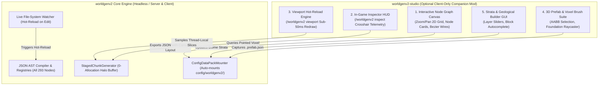
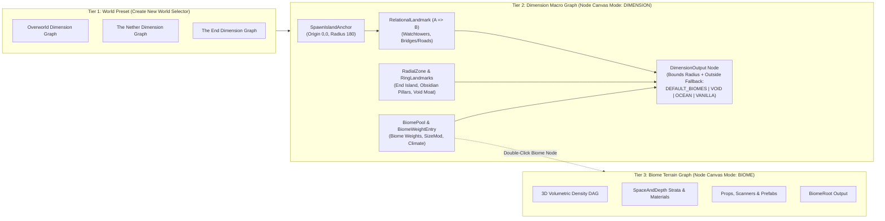

# Minecraft Worldgen V2: Studio Companion & Creator Workflow Architecture Plan

> **Companion Documents:**
> - [ROADMAP_AND_PROGRESS.md](ROADMAP_AND_PROGRESS.md) — Master Implementation Roadmap & Milestone Tracker
> - [07_ASSET_SCHEMA_AND_NODE_GRAPH_SPECIFICATION.md](research/07_ASSET_SCHEMA_AND_NODE_GRAPH_SPECIFICATION.md) — Asset Schemas & Node Graph Execution
> - [15_MODPACK_AUTHORING_AND_STUDIO_WORKFLOW.md](research/15_MODPACK_AUTHORING_AND_STUDIO_WORKFLOW.md) — Modpack Authoring & Studio Workflow Specification

---

## 1. Executive Architecture Overview

With the core volumetric generation engine, 3D math, surface strata rules, prop pipelines, and all 293 AST node types **100% complete and verified**, the active engineering frontier focuses on **Creator Authoring Tools**:



---

## 2. `worldgenv2-studio` Companion Mod Architecture

The `worldgenv2-studio` mod is a client-only companion mod built for world designers, pack developers, and technical artists. It provides visual, interactive, and WYSIWYG creation tools inside the live game.

### 2.1 Authentic Vanilla-Esque UI Architecture & Design Language

The studio is designed from the ground up to feel like an organic part of Minecraft:
*   **Aesthetic & Theming**:
    *   Directly follows Minecraft's visual language: beveled stone borders, dirt/dark-slate tiled background textures (`Screen.renderBackground`), vanilla typography, and button press depth.
    *   Styled after the **Advancements Screen** (tabbed navigation headers, framed central canvas, corner rivets) and **Options / Settings Screen** (sliders, toggles, beveled control frames).
    *   Authentic vanilla audio cues: `SoundEvents.UI_BUTTON_CLICK` for interactions, discrete toggle clicks.
*   **Custom Vanilla Dropdown Menus (`VanillaDropdownWidget`)**:
    *   Replaces generic modern flat dropdowns with authentic Minecraft-style popup selectors:
        *   Standard state: Beveled dark-slate box displaying active selection with a crisp vanilla down-arrow chevron (`▼`).
        *   Expanded state: Smoothly animates open into a framed list overlay with vanilla scrollbars and hover-highlighted row frames.
        *   Supports nested subcategories, block/item thumbnail icons, and hotkey shortcuts.
*   **Tabbed Workspace Navigation**:
    *   Advancements-style top tabs:
        *   `Node Canvas`: Full visual AST node editor for the active biome.
        *   `Strata Builder`: Layered geological stack editor.
        *   `Prefab Brush`: 3D structure selection, foundation plinth tuning, and socket placement.
        *   `Chunk Viewport`: Live testing chunk selector and regeneration console.
        *   `WorldGen Codex`: Built-in wiki, node manual, and "Ponder-esque" 3D visualizer.

---

### 2.2 Visual Node Editor Canvas & Interaction Mechanics

The centerpiece of the studio is a full-screen, GPU-accelerated node canvas accessible in-game (via keybind or `/worldgenv2 studio`):

*   **Pannable & Zoomable 2D Infinite Grid**:
    *   Smooth mouse-drag panning, scroll-wheel zooming ($0.2\times$ to $2.0\times$), and spatial grid lines.
    *   Minimap overview in the corner showing the entire graph with quick-viewport navigation.
*   **Double-Click to Add Node & Smart Search**:
    *   **Double-clicking** anywhere on the empty canvas immediately opens the **Smart Search Drawer** pinned at the exact cursor position.
    *   Alternative activation: `Spacebar` or `Right-Click` on canvas.
    *   **Smart Fuzzy Search**: Instant keystroke filtering across all 293 node types.
    *   **Category Tabs & Filter Chips**: Quick-filter by domain (Density, Curves, Vectors, Materials, Props, Positions, Scanners, Procedural Graph).
    *   **Search Aliases & Semantic Keywords**:
        *   Typing `"cave"` matches `CellWallDistance`, `YSampledDensity`, `ClampDensity`, and `Sphere`.
        *   Typing `"strata"` matches `SpaceAndDepthMaterialProvider` and `QueueMaterialProvider`.
        *   Typing `"mountain"` matches `SumDensity`, `ManualCurve`, and `FastNoiseLite`.
    *   **Recently Used & Favorites**: Top row pinned with recently created nodes for lightning-fast authoring.
*   **Strongly Typed Node Cards**:
    *   Color-coded category headers:
        *   🟢 **Green**: Volumetric Density & Math
        *   🔵 **Blue**: 1D Transfer Curves & Sigmoids
        *   🟠 **Orange**: 3D Vector Providers & Domain Warping
        *   🟣 **Purple**: Material Providers & Surface Strata
        *   🟡 **Yellow**: Props, Assignments & Prefabs
        *   🔷 **Cyan**: Positions Providers & Scanners
        *   🔴 **Red**: Procedural Graph Generator
    *   Inline parameter widgets: number sliders, text fields, dropdown selectors, and boolean toggles directly on the card.
*   **Typed Socket System & Validation**:
    *   Left-side input sockets and right-side output sockets.
    *   Connection validation prevents invalid connections (e.g. dragging a `VectorProvider` output into a `Curve` input flashes red and rejects).
*   **Cubic Bezier Wire Rendering**:
    *   Smooth cubic Bezier splines: $\mathbf{B}(t) = (1-t)^3 \mathbf{P}_0 + 3(1-t)^2 t \mathbf{P}_1 + 3(1-t)t^2 \mathbf{P}_2 + t^3 \mathbf{P}_3$.
    *   Animated data flow pulses indicating active graph execution.
*   **Canvas UI Metadata Persistence (`Editor.Position: {X, Y}`)**:
    *   Preserve node canvas coordinates, collapsed state, and comments directly in biome JSON:
        ```json
        {
          "name": "minecraft:temperate_forest",
          "type": "TileBiome",
          "terrain": {
            "type": "SumDensity",
            "Editor": {
              "position": { "x": 420.0, "y": 180.0 },
              "collapsed": false,
              "comment": "Combines gravity gradient with rolling hills and 3D arches"
            },
            "inputs": [ ... ]
          }
        }
        ```
    *   Resizable colored comment backdrop boxes grouping subgraphs (e.g., "Overhang Density Math", "Surface Flora Queue").
    *   Zero runtime overhead: skipped by the headless server engine.

---

### 2.3 Live Testing Chunk Selector & Real-Time Viewport Engine

Iterating on terrain in real time without losing your frame of reference:

*   **Convenient & Simple Visual Chunk Selector**:
    *   Provides two complementary ways to select test chunks:
        1. **2D Chunk Grid Minimap**: Top-down interactive chunk grid centered on the player. Click individual chunks or drag-select a rectangular bounding box.
        2. **3D In-World Selection Wand**: Raycast click in the 3D world to pick target chunks directly.
    *   **Quick Presets**: `Single Chunk (1x1)`, `Local Area (3x3)`, `Cross (5 Chunks)`, `Custom Box Selection`, and `Follow Player`.
*   **Visual Indication with Auto-Hiding Confirmation**:
    *   **Selection Phase**:
        *   Selected chunks are rendered with glowing translucent hologram columns extending from bedrock to world ceiling.
        *   Chunk section boundaries (16-block intervals) glow with soft neon accents.
    *   **Confirmation Action ("Confirm Chunks" / "Apply Viewport")**:
        *   Clicking **Confirm** locks the live testing volume for immediate regeneration.
        *   **Crucial UX Behavior**: Confirmation **automatically fades out / hides the glowing boundary indicators**, ensuring a pristine, unobstructed view of the sculpted terrain, cliffs, trees, and caves!
        *   A discreet status badge on the HUD (`Viewport: 3x3 [Active]`) confirms the region is locked, with a single-click button or hotkey to re-show boundaries at any time.
*   **Sub-50ms Hot-Reload Redraw Buffer**:
    *   When an editor slider moves or a node connection changes, the engine recalculates only the active test chunks using `ThreadLocal<ColumnScratch>`.
    *   Direct voxel geometry updates in the live client view with zero world save corruption.

---

### 2.4 Built-In WorldGen Codex & In-Game "Wiki"

Technical world generation requires rich, accessible reference material directly inside the client:

*   **Integrated In-Game Guide & Wiki Panel**:
    *   Searchable documentation codex accessible via the `WorldGen Codex` tab.
    *   Exhaustive guide to all 293 AST nodes, categorized by domain.
    *   Explains mathematical concepts in plain English with formulas, parameters, and practical Minecraft examples.
*   **Default Biome Reference Library**:
    *   Pre-loaded with all **39 built-in default biomes** (Alpine Peaks, Autumn Forest, Badlands, Bamboo Jungle, Basalt Deltas, Crimson Forest, Dark Forest, Deep Ocean, Desert, etc.).
    *   Acts as an interactive learning laboratory: users can inspect how official biomes solve overhangs, continental shelves, cave carving, and strata.
    *   One-click **"Clone as New Custom Biome"** button to start creating from a working template.
*   **Rich Examples Library**:
    *   Pre-configured subgraph snippets ready to copy/paste:
        *   *Sharp Mountain Spines* (Worley CellWallDistance + Hermite Spline)
        *   *Floating Skylands* (Inverted Ellipsoid SDF + 3D Simplex Warp)
        *   *Eroded River Canyons* (RadialScanner + DistanceSCurve)
        *   *Subterranean Cavern Networks* (YSampledDensity + Swiss Cheese Noise)
        *   *Layered Sedimentary Strata* (SpaceAndDepth with Slope Cutoffs)
*   **Mini Visuals & Inline Graphs**:
    *   Interactive 2D mini-plots for curve nodes showing the transfer response curve $y = f(x)$ as points move.
    *   2D cross-sectional slice heatmaps for density nodes.
    *   Raycast diagrams illustrating how surface scanners detect blocks.

---

### 2.5 "Ponder-Esque" 3D Concept Visualizer

Inspired by the acclaimed Create mod's Ponder system, this feature provides interactive, step-by-step 3D visual walkthroughs in miniature isometric dioramas:

*   **Step-by-Step Interactive Walkthroughs**:
    *   Users can scrub forward and backward through sequential procedural stages:
        1. **Stage 1: Base Volumetric Gradient**: Shows the initial gravitational gradient $D(y)$ forming a flat plane.
        2. **Stage 2: 3D Simplex Domain Warping**: Visualizes how vector noise displaces $(x, y, z)$ coordinates, morphing the flat plane into rolling hills and dramatic overhangs.
        3. **Stage 3: Subterranean Cave Carving**: Demonstrates how cave density functions subtract volume from solid terrain where $D_{\text{cave}} > 0$.
        4. **Stage 4: Strata Layer Draping**: Shows `SpaceAndDepthMaterialProvider` marching down from the exposed surface, assigning grass, subsoil, and deep stone based on depth and slope.
        5. **Stage 5: Surface Scanner Raycasting**: Illustrates `LinearScanner` dropping vertical test rays from the sky to locate valid spawn surfaces for trees and rocks.
        6. **Stage 6: Adaptive Foundation Plinths**: Shows a prefab house being placed on an uneven hillside, with foundation pillars automatically raycasting downward to anchor into the stone.
        7. **Stage 7: Voronoi Biome Transition**: Displays two adjacent biomes blending smoothly across the transition boundary using BiCarta 5×5 distance weighting.
*   **Interactive Playback Controls**:
    *   Play, Pause, Step Forward, Step Backward, Timeline Slider.
    *   Free-orbit isometric camera: left-click drag to rotate around the diorama, scroll to zoom.
    *   Text annotations pinned to 3D points in the miniature scene explaining what each algorithm is doing.

---

### 2.6 4-Tier World Preset & 2-Level Node Graph Architecture (Dimension Macro Graph <-> Biome Micro Graph)

To empower creators to author entire worlds, multi-dimension presets, End-style concentric ring layouts, and procedural starter islands with connected landmarks, the Studio employs a unified **4-Tier Hierarchy** and a **2-Level Node Editor**:



*   **1. Whole-World Presets & "Create New World" Screen Integration**:
    *   World Presets package multi-dimension configurations (`Overworld`, `The Nether`, `The End`, `Hytale 576`) into selectable presets on Minecraft's **Create New World -> World Tab -> World Type** button:
        *   `worldgenv2:volumetric` — Standard 3D Volumetric Overworld + End Rings + Nether.
        *   `worldgenv2:volumetric_hytale` — Hytale Extended 576-block height world preset.
        *   `worldgenv2:spawn_island_landmarks` — Isolated Spawn Island with procedurally placed and road-connected landmarks, transitioning to Ocean and Default Biomes beyond bounds.
        *   `worldgenv2:end_rings_archipelago` — Concentric End Dimension layout (Central Island + 10 Obsidian Pillars + Void Moat + Outer Archipelago Islands) and custom Overworld.
    *   Exporting from the Studio saves both the individual biome JSONs (`config/worldgenv2/biomes/`) and the dimension/world preset JSONs (`config/worldgenv2/worlds/` and `config/worldgenv2/presets/`).

*   **2. 2-Level Node Editor Mode Switcher (`[Dimension Graph]` <-> `[Biome Graph]`)**:
    *   A mode toggle button directly on the Node Editor toolbar switches the canvas between:
        *   **`[Graph: Biome Terrain]`**: Edits the 3D density, curves, materials, and props of the selected biome.
        *   **`[Graph: Dimension Macro]`**: Edits the macro spatial layout, biome weights, radial zones, spawn island, connected landmarks, and outside-bounds fallback of the active dimension!
    *   **Step-In Workflow**: Double-clicking any `BiomeWeightEntry` node inside the Dimension Graph automatically switches into `[Graph: Biome Terrain]` mode and loads that biome's terrain graph.

*   **3. Macro Dimension Nodes & Outside-Bounds Fallback System**:
    *   **`Dimension:DimensionOutput` (Master Dimension Output & Fallback Node)**:
        *   Inputs: `zones` (RadialZones / SpawnIslandAnchor), `biomePool` (BiomePool / BiomeWeightEntries), `landmarks` (MacroFeatureGraph / RingLandmarks).
        *   Parameters:
            *   `seaLevel` (int, e.g., `63` or `0` for End)
            *   `defaultBlock` (Block picker, e.g., `minecraft:stone`, `minecraft:end_stone`, `minecraft:netherrack`)
            *   `fluidBlock` (Block picker, e.g., `minecraft:water`, `minecraft:lava`, `minecraft:air`)
            *   `cellSize` (int, Voronoi biome cell size in blocks, e.g., `288`)
            *   `boundsRadius` (float, `0` = infinite, `> 0` = finite custom modification radius around origin)
            *   `blendFalloff` (float, smooth C1 cubic transition width in blocks at the boundary)
            *   `outsideFallback` (Enum):
                *   `DEFAULT_BIOMES`: Everything outside `boundsRadius` seamlessly blends into the dimension's infinite weighted Voronoi biome pool.
                *   `VOID`: Everything outside `boundsRadius` drops off into empty void air (Skyblock / floating island worlds / bounded arenas).
                *   `OCEAN`: Everything outside `boundsRadius` depresses below sea level into an endless ocean basin.
                *   `VANILLA_DEFAULT`: Hands terrain outside `boundsRadius` back to standard dimension generation.
    *   **`Dimension:RadialZone` (Concentric Ring & Zone Mask Node — "The End" Architecture)**:
        *   Defines a radial disk or ring (`innerRadius` to `outerRadius` around `centerX, centerZ` with `falloff` transition width).
        *   `zoneMode` options:
            *   `ISLAND_PLATEAU`: Sculpts a solid floating or coastal island plateau within `[innerRadius, outerRadius]` (e.g., Central End Island `R: 0..220`).
            *   `VOID_MOAT`: Carves terrain to empty void within `[innerRadius, outerRadius]` (e.g., End abyss moat `R: 220..1000`).
            *   `BIOME_OVERRIDE`: Forces a specific target biome within `[innerRadius, outerRadius]`.
            *   `OUTER_ISLANDS`: Generates 3D volumetric floating archipelago islands and void gaps within `[innerRadius, outerRadius]` (e.g., Outer End Islands `R: 1000..4000`).
    *   **`Dimension:RingLandmarks` (Circular Pillar / Landmark Array Node)**:
        *   Places `count` procedural pillars or structures evenly on a ring of `radius` around `(centerX, centerZ)` with configurable `minHeight`, `maxHeight`, `pillarRadius`, `pillarBlock` (e.g. `minecraft:obsidian`), and `capBlock` (e.g. `minecraft:bedrock` / crystal).
    *   **`Dimension:SpawnIslandAnchor` & `Dimension:RelationalLandmark` (`A => B` Connected Landmarks)**:
        *   `SpawnIslandAnchor`: Creates a starter island at `(originX, originZ)` with `islandRadius`, `oceanBuffer`, `minElevation`, `maxElevation`, and `spawnBiome`.
        *   `RelationalLandmark`: Connects to a parent anchor (`SpawnIslandAnchor` or primary landmark) and procedurally places satellite landmarks at `[minDistance, maxDistance]` with automatic `SplineRoadEngine` stone causeways / bridges linking them across terrain and water!
    *   **`Dimension:BiomeWeightEntry` & `Dimension:BiomePool` (Per-Dimension Biome Assignment & Weights)**:
        *   Lets creators assign specific biomes to the dimension, tune `weight`, `sizeModifier`, `transitionDistance`, and climate coordinates (`continentalness`, `temperature`, `humidity`), and wire them into `Dimension:BiomePool` -> `Dimension:DimensionOutput`.

*   **4. Interactive 2D Macro Map & Landmark Preview**:
    *   In the Studio `Test Chunks / Macro Map` tab (and live in the world), creators can toggle between **Local Chunk View** and **Macro Dimension Map View (`-1500..+1500` blocks)**, displaying radial rings, void moats, spawn island boundaries, outside-bounds fallback zones, placed landmarks, obsidian tower rings, and connecting road/bridge splines!

---

### 2.7 Proactive Diagnostics, Warnings & Rich Tooltips

Catching mistakes before testing in-world:

*   **Rich Mathematical & Practical Tooltips**:
    *   Hovering over any socket, parameter, or slider reveals:
        *   The mathematical formula governing the node (e.g., $D = A \times (1-t) + B \times t$).
        *   The practical Minecraft effect (e.g., "Determines the cliff angle at which grass transitions into bare rock").
        *   Expected input ranges and recommended defaults (e.g., $[-1.0, 1.0]$, $[0^\circ, 90^\circ]$).
*   **Real-Time Non-Blocking Warning Badges**:
    *   Visual alert icons on node cards and on the canvas status bar:
        *   ⚠️ **Disconnected Output**: Highlights nodes whose outputs are not connected to the biome root.
        *   ⚠️ **Circular Reference**: Flags infinite dependency loops in the graph.
        *   ⚠️ **Type Mismatch**: Flashes red if incompatible socket types are connected.
        *   ⚠️ **Extreme World Height Performance Warning**: Triggered when generation depth $> 512$ blocks, detailing RAM usage, packet sizes, and chunk meshing latency ("Deal with Consequences").
        *   ⚠️ **Extreme Frequency / Scale**: Warns when noise frequency $< 0.0001$ or $> 0.5$ (preventing visual aliasing or flat planes).
        *   ⚠️ **Unresolved Block Identifier**: Flags misspelled block IDs with suggested autocompletions.

---

### 2.8 Visual Block Palette Browser & Modded Block Selector

Selecting blocks must be visual, intuitive, and mod-aware:

*   **Live 3D/2D Block Item Icons**:
    *   Every block selector button, dropdown, and strata layer renders the **actual in-game block item model** using `guiGraphics.renderFakeItem(...)` and block model renderers.
    *   Fully supports **modded blocks** (`biomesoplenty:*`, `create:*`, `quark:*`, etc.) with authentic textures, lighting, and biome colormaps.
*   **Visual Block Search Drawer (Creative Inventory / JEI Aesthetic)**:
    *   Clicking any block property opens a framed, vanilla-style visual palette modal.
    *   **Visual Block Grid**: Scrollable grid of block icons with smooth hover highlights and item counts.
    *   **Multi-Modal Search Bar**:
        *   Search by localized display name (e.g., `stone`, `cut granite`, `deepslate`).
        *   Search by mod namespace using `@` prefix (e.g., `@create`, `@biomesoplenty`, `@minecraft`).
        *   Search by block tag using `#` prefix (e.g., `#minecraft:base_stone_overworld`, `#c:sandstone`, `#minecraft:dirt`).
    *   **Rich Block Hover Tooltip**: Displays the block's localized name, full registry ID (`modid:block_name`), parent mod name, and configurable block state properties (e.g., `axis=y`, `snowy=true`, `facing=north`).
    *   **Visual Selection Button / Pill**: Renders the selected block's icon right beside the text label (e.g., `[ 🪨 Stone (minecraft:stone) ▾ ]`).

---

### 2.9 In-Game Inspector HUD (`/worldgenv2 inspect`)

A real-time developer HUD active while traversing the world in creative mode:

*   **Crosshair Voxel Readout**:
    *   Target block coordinate $(x, y, z)$.
    *   Exact 3D continuous density value $D(x, y, z)$.
    *   Surface normal vector $\mathbf{N} = -\nabla D$ and computed slope angle $\theta = \arccos(n_y)$ in degrees.
    *   Active Voronoi cell ID, cell seed, and normalized neighbor transition blend weights.
    *   Active `MaterialProvider` rule and matching `Pattern` (Floor, Wall, Ceiling, Slope, Depth).
*   **Translucent 2D/3D Density Heatmap Overlay**:
    *   Pressing `F8` renders a slice of the active density field in front of the player, showing where terrain will generate, where caves will carve, and where transitions occur.

---


### 2.10 3D Prefab & Voxel Brush Suite

Designing and capturing structure templates with adaptive foundations:

*   **In-Game Selection Wand**:
    *   Select coordinate anchors $P_1$ and $P_2$ to define a 3D bounding box.
    *   Extracts blocks into native `.prefab.json` format, automatically detecting palettes, air masks, and block rotations.
*   **Adaptive Foundation Plinth Visualizer**:
    *   Shows vertical projection rays marching downward from foundation blocks, highlighting how pillars will anchor into uneven hills or slopes.
*   **Socket Connector Editor**:
    *   Place 3D socket markers (e.g. `ROAD_OUTLET`, `DOORWAY`, `DEFENSIVE_PERIMETER`) on the structure, defining connection points for procedural roads and relational landmarks.

---

### 2.11 Strata & Geological Layer Builder GUI

Interactive layer composition without writing JSON by hand:

*   **Stratified Stack Visualizer**:
    *   Vertical bar representing ground layers from surface downward.
    *   Drag-and-drop layer reordering (e.g., swapping Podzol and Coarse Dirt).
    *   Thickness sliders (`Constant`, `RangeThickness`, `NoiseThickness`).
    *   Slope cutoff angle slider with visual cliff steepness indicator.
*   **Modded Block Palette Browser**:
    *   Search bar querying all registered blocks in the modpack (`minecraft:*`, `biomesoplenty:*`, `create:*`, etc.).
    *   Displays block item icons, block state property selectors (e.g. `axis=y`, `snowy=true`), and tag fallback suggestions.

---

### 2.12 One-Click Datapack Packaging & Clean Diff Serializer

Exporting clean configurations ready for modpack distribution:

*   **One-Click "Save & Export"**:
    *   Serializes biome ASTs, dimensions, and strata to formatted JSON with node canvas coordinates into `config/worldgenv2/biomes/`.
*   **Clean Diff Serializer**:
    *   Indented formatting with default-field omission, ensuring clean Git diffs in modpack repositories.
*   **Multi-Dimension Datapack Packaging**:
    *   One-click export packages matching `dimension/<name>.json`, `dimension_type/<name>.json`, and dimension-scoped `worldgenv2/` biome directories.

---

## 3. Modpack Creator Datapack Workflow (Core Mod Integration)

How `worldgenv2` integrates seamlessly into modpack creator instances:

### 3.1 Synthetic Global Datapack Auto-Mounter
*   **`ConfigDataPackMounter.java`**:
    *   Injects a synthetic `Pack` into Minecraft's `PackRepository` representing `config/worldgenv2/`.
    *   Has top priority over vanilla and mod resources, ensuring user presets instantly override defaults without compiling JARs or packaging zip archives.

### 3.2 Live File-System Watcher & Cache Invalidation
*   **`ConfigWatcherService`**:
    *   Java NIO `WatchService` monitoring `config/worldgenv2/` on a background daemon thread.
    *   On file save (`ENTRY_MODIFY` / `ENTRY_CREATE`), triggers atomic cache invalidation in `JsonAstCompiler` and `BiCarta`.
    *   Runs `/worldgenv2 reload` automatically, updating the world seamlessly in singleplayer dev environments.

### 3.3 Core Mod World Height Architecture (Completed)
*   **`WorldHeightConfig.java`**: Implements `STANDARD`, `HYTALE_512`, `HYTALE_EXTENDED`, `EPIC_1024`, and `CUSTOM` parsing with 16-block section alignment.
*   **Hytale Dimension Type**: Shipped `worldgenv2:overworld_hytale` (576 blocks, $Y \in [-64, 512]$) and `world_preset/volumetric_hytale.json`.
*   **Dynamic Column Allocation**: `ColumnScratch.ensureCapacity()` automatically scales scratch buffers for arbitrary heights up to 2048 blocks without garbage collection churn.
*   **Diagnostic Telemetry**: `/worldgenv2 info` dynamically reports the active world $[Y_{min} \dots Y_{max}]$, depth, sea level, and preset.

### 3.4 Dimension & Biome Environment Parameterization (Completed)
*   **Dimension-Level Customizability**: `WorldGenV2ChunkGenerator` accepts `default_block`, `default_fluid`, `has_ceiling`, `ceiling_y`, `ceiling_thickness`, and `deep_lava_flooding`.
*   **Bedrock Ceiling & Above-Roof Airspace**: Solid terrain is sealed with bedrock at `ceiling_y`, while all airspace above `ceiling_y` up to `maxY` is cleared to open air for player building.
*   **Biome-Level Customizability**: `TileBiome`, `BiomeDefinition`, and `JsonAstCompiler` support per-biome `defaultBlock`, `fluidBlock`, and `seaLevel` overrides with dynamic `Identifier` block resolution.

### 3.5 Third-Party Addon Mod Ecosystem & Developer API

Enabling external creators to publish standalone "Biomes O' Plenty" style addon mods designed specifically for WorldGen V2:

*   **Multi-Mod Classpath Resource Discovery**:
    *   Query Minecraft's active `ResourceManager` across all loaded mod namespaces (`data/*/worldgenv2/biomes/*.json` and `data/*/worldgenv2/prefabs/*.prefab.json`).
    *   Allows any addon JAR (e.g. `mysticbiomes.jar`) placed in `mods/` to be automatically discovered, compiled, and registered without user configuration.
*   **Dimension & Climate Targeting in Biome Definitions**:
    *   Biome JSONs declare target dimensions (`"dimensions": ["minecraft:overworld"]`, `"minecraft:the_nether"`, or custom dimensions).
    *   Voronoi cellular mapping uses the biome's `ClimateTarget` (`temperature`, `humidity`, `continentalness`, `erosion`, `weirdness`) to automatically place addon biomes in realistic geographic positions.
*   **Public Extensibility API (`worldgenv2-api`)**:
    *   Allow third-party mods to register custom AST Density nodes, Curve algorithms, and Prop placements using `WorldGenV2Registries`.
    *   Provide NeoForge mod bus events (`RegisterWorldGenV2BiomesEvent`) for programmatic Java biome registration.
*   **Vanilla Biome Compatibility Bridge (Ingesting External Mods)**:
    *   `BiomeAutoSynthesizer`: Automatically converts traditional vanilla-style biome mods (official Biomes O' Plenty, Terralith, Regions Unexplored) into 3D volumetric density terrain curves.
    *   `FeatureCompatibilityBridge`: Ingests and places external mod `PlacedFeatures` (custom trees, ores, foliage) during the prop pipeline pass.
    *   `ModdedBlockResolver`: Robust blockstate lookup supporting third-party modded blocks and fallback cascades.

---

## 4. World Fundamentals Polish (Phase 7 Completion)

Completing the final natural world features:

*   **Riparian Shoreline CustomBiome**:
    *   Shoreline biome corridor flanking river channels (weeping willows, river stones, reeds, clay beds).
*   **Downhill-Monotonic Rivers & River Deltas**:
    *   Hydraulic solver ensuring riverbeds flow strictly downhill toward oceans, widening into marshy deltas at coastal mouths.
*   **Subterranean 3D Flora & Cave Props**:
    *   Procedural stalactites, stalagmites, hanging roots, and glow berry vines placed via `CuboidProp` and `LinearScanner`.
*   **In-Game Visual Tuning Pass**:
    *   Global parameter polish across all 39 biomes (heights, ocean continental shelves, peak snowlines).
