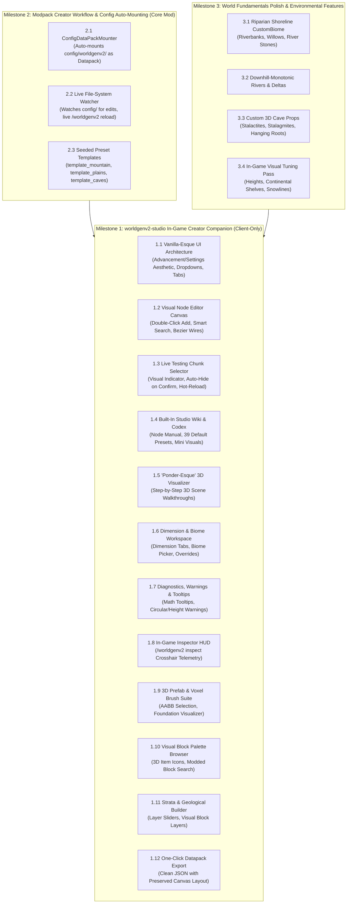

# Minecraft Worldgen V2 — Master Implementation Roadmap & Active Milestones

This document is the **single source of truth** for tracking active development milestones, next steps, and architectural goals for the **Minecraft Worldgen V2** (`com.worldgenv2`) procedural world generation engine and its companion tooling.

---

## 🏆 Completed Foundation (Phases 1–5 & 8–14: 100% Verified)

All foundational mathematics, volumetric density functions, surface strata rules, prop pipelines, and node-graph AST compilation have been completed and verified across all test suites:

| Subsystem | Scope & Parity | Status | Verification Suite |
| :--- | :--- | :--- | :--- |
| **Core Volumetric Math & Pipeline** | `DensityFunction`, `FastNoiseLite` SIMD, `YSampledDensity`, `GradientWarp`, `BiCarta` 5×5 Voronoi, `StagedChunkGenerator` halo | 🟢 **100% Completed** | `verifyEngine`, `verifyPhase3And4` |
| **Materials, Patterns & Props** | `SpaceAndDepth`, `QueueMaterialProvider`, `WeightedMaterialProvider`, `SurfacePattern`, `SlopePattern`, `BlockProp`, `CuboidProp`, `PrefabProp` | 🟢 **100% Completed** | `verifyEngine` |
| **Minecraft 26.1 Runtime Adapter** | `WorldGenV2ChunkGenerator`, `WorldGenV2BiomeSource`, `MinecraftVoxelSpace`, `WorldGenV2Mod`, CLI commands | 🟢 **100% Completed** | `verifyEngine`, `verifyPhase7` |
| **Phase 8: Curves & Vector Providers** | 19 Curve nodes (`ManualCurve`, Hermite splines, `DistanceSCurve`), 17 Vector nodes (`DensityGradient` $\nabla D$, domain warping) | 🟢 **100% Completed** | `verifyPhase8` (72 tests) |
| **Phase 9: Advanced Density Nodes** | 3D SDF primitives (`Ellipsoid`, `Cuboid`, `Cylinder`, `Plane`, `Shell`), Worley `CellWallDistance`, Logic gates, `CacheDensity`, `SingleInstance` | 🟢 **100% Completed** | `verifyPhase9` (49 tests) |
| **Phase 10: Positions, Scanners & Assignments** | `TriangularGrid2d`, `SquareGrid`, `PoissonDisk`, `Jitter2d/3d`, `LinearScanner`, `RadialScanner`, `SandwichAssignment`, `AssignmentsProp` | 🟢 **100% Completed** | `verifyPhase10` (22 tests) |
| **Phase 11: Block Masks & Advanced Props** | `SourceMaterial` vs `DestinationMaterial`, `DontPlaceMask`, `DontReplaceMask`, `AdvancedBlockMask` $N \times M$ matrix, `RandomRotatorProp`, `UnionProp` | 🟢 **100% Completed** | `verifyPhase11` (50 tests) |
| **Phase 12: Procedural Graph Subsystem** | Macro topological network passes, node/edge selectors & actions, Delaunay proximity connectors, river/road content attachment | 🟢 **100% Completed** | `verifyPhase12` (69 tests) |
| **Phase 13: Prop Runtime Context Precision** | Dynamic chunk bounds, `BIOME` / `CHUNK` / `PROP` precision modes, zero-cascading chunk generation guarantees | 🟢 **100% Completed** | `verifyPhase13` (63 tests) |
| **Phase 14: Complete JSON AST Parity** | Full AST serializer/deserializer & optimizer for all 293 node types across all 24 official categories | 🟢 **100% Completed** | `verifyPhase14` (107 tests) |

---

## 🎯 Active Milestones & Next Steps



---

## Milestone 1: `worldgenv2-studio` In-Game Creator Companion (Client-Only Mod)

The **`worldgenv2-studio`** companion mod is an interactive, visual WYSIWYG creation suite designed for modpack creators, world designers, and server authors. It is client-only and omitted from survival player modpacks.

### 1.1 Authentic Vanilla-Esque UI Architecture & Design Language
- [ ] **Minecraft Aesthetic & Theming**:
  - True-to-vanilla visuals styled after the Advancements screen, Options/Settings menus, and Recipe Book.
  - Authentic dirt and dark-slate background textures with vanilla beveled stone framing and tabs.
  - Native Minecraft fonts, button press animations, and vanilla sound feedback (`UI_BUTTON_CLICK`).
- [ ] **Vanilla-Styled Dropdown Menus**:
  - Custom `VanillaDropdownWidget`: beveled rectangular box with chevron indicator, click-to-expand popup list, smooth vanilla scrollbars, and keyboard arrow navigation.
  - Dropdown options support category headers, item/block icon prefixes, and shortcut badges.
- [ ] **Tabbed Workspace Shell**:
  - Top navigation tabs modeled after the Advancements GUI (e.g., `Node Canvas`, `Strata Builder`, `Prefab Brush`, `Chunk Viewport`, `WorldGen Wiki`).
  - Smooth transitions and persistent sub-state preservation between tabs.

### 1.2 Infinite Node Canvas & Smart Node Placement
- [ ] **Zoomable & Pannable 2D Canvas**: Smooth infinite grid canvas with grid snapping, multi-selection bounding box, and minimap navigation ($0.2\times$ to $2.0\times$ zoom).
- [ ] **Double-Click Node Creation & Smart Search**:
  - Double-clicking anywhere on the empty canvas summons the **Smart Search Drawer** at the exact cursor position.
  - Shortcut options: `Double-Click`, `Space`, or `Right-Click` on canvas.
  - **Fuzzy Search & Category Filtering**: Instantly filters all 293 node types by category (Density, Curves, Vectors, Materials, Props, Positions, Scanners, Graph).
  - **Search Aliases & Semantic Tags**: Typing `"cave"` surfaces `CellWallDistance`, `YSampledDensity`, and `ClampDensity`; typing `"strata"` surfaces `SpaceAndDepthMaterialProvider` and `QueueMaterialProvider`.
- [ ] **Strongly Typed Node Cards & Sockets**:
  - Color-coded headers by domain (Green: Density, Blue: Curves, Orange: Vector, Purple: Material, Yellow: Props, Cyan: Positions/Scanners).
  - Strongly typed input/output sockets with real-time validation (rejects incompatible connections with a subtle red pulse).
- [ ] **Bezier Wire Renderer**: Smooth cubic Bezier curves connecting node sockets with animated data flow arrows indicating execution direction.
- [ ] **Canvas UI Metadata Persistence (`Editor.Position: {X, Y}`)**:
  - Preserve node canvas coordinates, collapsed state, and comments directly in biome JSON:
    ```json
    "Editor": {
      "Position": { "X": 320.0, "Y": -140.0 },
      "Collapsed": false,
      "Comment": "Calculates 3D arch density"
    }
    ```
  - Visual grouping and resizable colored comment boxes for subgraphs.
  - Zero runtime overhead: skipped by the headless server engine.

### 1.3 Live Testing Chunk Selector & Real-Time Viewport Engine
- [ ] **Convenient Visual Chunk Selector**:
  - Intuitive chunk grid overlay and in-world 3D selector allowing creators to designate specific live test chunks.
  - Preset chunk selections: `Single Chunk (1x1)`, `Local Area (3x3)`, `Cross (5 Chunks)`, `Custom Box Selection`, and `Follow Player`.
- [ ] **Clear Visual Indication with Auto-Hiding Confirmation**:
  - **Selection Mode**: Selected chunks glow with translucent vertical hologram columns and glowing chunk section boundaries (similar to F3+G but stylized).
  - **"Confirm Chunks" / "Apply Viewport" Action**: Clicking the confirmation button locks the live testing volume and **automatically hides the glowing visual boundaries**, ensuring a pristine, unobstructed view of the generating terrain.
  - Easily re-summon or adjust the chunk boundaries with a single hotkey or button click.
- [ ] **Sub-50ms Hot-Reload Redraw Buffer**:
  - Changing sliders or node parameters triggers thread-local recalculation of only the active test chunks.
  - Instant visual feedback directly in the live world without saving or restarting the game.

### 1.4 Built-In WorldGen Codex & In-Game "Wiki"
- [ ] **Integrated In-Game Guide & Wiki Panel**:
  - Full-featured documentation browser directly accessible inside the Studio menu.
  - Searchable glossary of all 293 AST nodes, explaining mathematical formulas, input ranges, and recommended usage.
- [ ] **Default Biome Reference Library**:
  - Ships with all 39 built-in default biomes (Alpine Peaks, Autumn Forest, Badlands, Bamboo Jungle, Crimson Forest, etc.) as starting reference points.
  - One-click "Clone as New Custom Biome" button to start tweaking an established, battle-tested graph.
- [ ] **Rich Examples Library**:
  - Ready-to-use graph snippets and templates: Mountain Ranges, Floating Skylands, 3D Overhang Arches, Layered Geological Strata, Subterranean Cavern Networks, and Dense Flora Scatters.
- [ ] **Mini Visuals & Inline Graphs**:
  - Real-time 2D mini-plots for curve nodes (Hermite splines, Sigmoids, SCurves).
  - 2D cross-sectional slice previews for density combinations.
  - Graphical raycast illustrations for surface scanners and slope angles.

### 1.5 "Ponder-Esque" 3D Concept Visualizer
- [ ] **Interactive 3D Miniature Scenes (Create Mod Inspired)**:
  - Dedicated visual walkthrough system providing interactive, step-by-step 3D animations explaining complex worldgen concepts in miniature isometric dioramas:
    1. **Density to Isosurface**: Visualizes how continuous 3D density scalar fields $D(x, y, z)$ resolve into solid voxels where $D \ge 0$.
    2. **Domain Warping**: Demonstrates how vector offset noise bends and distorts straight coordinates into organic terrain overhangs.
    3. **Strata Stacking**: Step-by-step visual showing how `SpaceAndDepthMaterialProvider` layers topsoil, subsoil, and bedrock relative to terrain depth and slope.
    4. **Surface Scanner & Raycasting**: Shows how `LinearScanner` and `RadialScanner` cast rays from the sky to find solid anchor points.
    5. **Adaptive Foundation Plinths**: Visualizes how prefab structures dynamically march foundation pillars downward to meet irregular slope topography.
    6. **Voronoi Biome Cell Blending**: Illustrates BiCarta 5×5 Voronoi distance fields and how neighbor transition weights blend smoothly between adjacent biomes.
  - Interactive playback controls: Play, Pause, Scrub Timeline, Rotate 3D Camera, and Step Forward/Back.

### 1.6 4-Tier World Preset & 2-Level Node Graph Architecture (Dimension Macro Graph <-> Biome Micro Graph)
- [x] **4-Tier Authoring Hierarchy**:
  - **Tier 1 — World Preset (Top Level)**: Complete multi-dimension preset package (`Overworld`, `The Nether`, `The End`, `Hytale 576`, custom dimensions) selectable directly on Minecraft's **Create New World -> World Tab -> World Type** screen (`worldgenv2:volumetric`, `worldgenv2:volumetric_hytale`, `worldgenv2:spawn_island_landmarks`, `worldgenv2:end_rings_archipelago`).
  - **Tier 2 — Dimension Macro Graph (Macro Layout)**: Node-based spatial layout for an entire dimension: radial rings, void moats, spawn islands, relational landmark constellations, biome weight pools, and **Outside-Bounds Fallbacks**.
  - **Tier 3 — Biome Terrain Graph (Meso Level)**: Full 3D volumetric density, curve, strata material, and prop node graph for an individual biome. Double-clicking any `BiomeWeightEntry` node in the Dimension Graph steps directly into that biome's terrain graph.
  - **Tier 4 — Procedural Landmarks & Spline Connections (Micro/Macro Anchor Level)**: Primary hubs, circular pillar arrays (End obsidian towers), and `A => B` relational satellites connected by `SplineRoadEngine` bridges and causeways.
- [x] **2-Level Node Editor Mode Switcher (`[Dimension Graph]` <-> `[Biome Graph]`)**:
  - Seamless toggle right on the Node Canvas toolbar switching between editing the **Active Dimension's Macro Layout Graph** and the **Active Biome's Terrain Graph**.
  - Built-in Dimension Macro Presets:
    - `Macro: Overworld Continent & Landmarks`
    - `Macro: Spawn Island + Connected Landmarks (Ocean/Default Fallback)`
    - `Macro: The End (Central Island + Obsidian Towers + Void Moat + Outer Islands)`
    - `Macro: Skyblock Bounded Archipelago (Void Fallback)`
- [x] **Macro Dimension Nodes & Outside-Bounds Fallback**:
  - **`Dimension:DimensionOutput`**: Master output node for a dimension configuring `seaLevel`, `defaultBlock`, `fluidBlock`, `cellSize`, `boundsRadius`, `blendFalloff`, and **`outsideFallback`**:
    - `DEFAULT_BIOMES`: Seamlessly blends into the dimension's infinite weighted Voronoi biome pool beyond `boundsRadius`.
    - `VOID`: Drops terrain density into empty void outside `boundsRadius` (for Skyblock, floating realms, or custom End dimensions).
    - `OCEAN`: Transitions into an endless sea basin at `seaLevel` outside `boundsRadius`.
    - `VANILLA_DEFAULT`: Hands control back to standard dimension terrain outside `boundsRadius`.
  - **`Dimension:RadialZone` (Concentric Rings & Void Moats — "The End" Architecture)**:
    - Defines radial disks or concentric rings (`centerX`, `centerZ`, `innerRadius`, `outerRadius`, `falloff`, `zoneMode`: `ISLAND_PLATEAU`, `VOID_MOAT`, `BIOME_OVERRIDE`, `OUTER_ISLANDS`, `targetBiome`).
    - Multiple `RadialZone` nodes chain into `DimensionOutput` to construct concentric dimension layouts (e.g., Central End Island `0..220` -> Void Moat `220..1000` -> Outer End Islands `1000+`).
  - **`Dimension:RingLandmarks` (Circular Pillar / Tower Arrays)**:
    - Places `count` procedural pillars or prefabs on a circle of `radius` around `(centerX, centerZ)` with deterministic heights, radii, and blocks (e.g., 10 End Obsidian Pillars with End Crystals).
  - **`Dimension:SpawnIslandAnchor` & `Dimension:RelationalLandmark` (`A => B` Connected Landmarks)**:
    - `SpawnIslandAnchor`: Forces a sculpted starter island at `(originX, originZ)` with configurable `islandRadius`, `oceanBuffer`, elevation range, and biome.
    - `RelationalLandmark`: Links to a parent anchor/landmark and procedurally places connected satellite landmarks within `[minDistance, maxDistance]`, automatically generating connecting `SplineRoadEngine` bridges/causeways.
  - **`Dimension:BiomeWeightEntry` & `Dimension:BiomePool` (Per-Dimension Biome Assignment & Weights)**:
    - Assigns biomes to the active dimension with interactive `weight`, `sizeModifier`, `transitionDistance`, and climate coordinates (`continentalness`, `temperature`, `humidity`).
- [x] **Interactive 2D Macro Map & Landmark Preview**:
  - Visualizes concentric radial zones, void moats, spawn island rings, outside-bounds fallback boundaries, placed landmarks, and connecting road/bridge splines in the Studio.

### 1.7 Proactive Diagnostics, Warnings & Rich Tooltips
- [ ] **Rich Mathematical & Practical Tooltips**:
  - Hovering over any socket, parameter, or slider displays:
    - Mathematical formula (e.g., $D = A \times (1-t) + B \times t$).
    - Practical Minecraft impact (e.g., "Controls how steep cliff faces must be before turning to bare stone").
    - Valid and recommended input ranges (e.g., $[-1.0, 1.0]$, $[0^\circ, 90^\circ]$).
- [ ] **Proactive Warning & Linting Badges**:
  - Real-time graph analysis displaying non-blocking warning badges:
    - ⚠️ **Disconnected Output**: Node output is not linked to any biome root output.
    - ⚠️ **Circular Reference**: Infinite dependency loop detected in the graph.
    - ⚠️ **Type Mismatch**: Attempted connection between incompatible socket domains.
    - ⚠️ **Extreme World Height**: Triggered when world depth $> 512$ blocks, detailing RAM, packet size, and chunk meshing implications.
    - ⚠️ **Extreme Frequency / Scale**: Warns when noise frequency will cause high-frequency visual aliasing or flat planes.
    - ⚠️ **Unresolved Block Identifier**: Flags misspelled modded block IDs with suggested registry autocompletions.

### 1.8 In-Game Inspector HUD & Crosshair Overlay (`/worldgenv2 inspect`)
- [ ] **Real-Time Crosshair HUD**:
  - Pointed voxel 3D scalar density $D(x, y, z)$ readout.
  - Active Voronoi cell ID, seed, and neighbor transition blend weights $[0.0, 0.5]$.
  - Surface normal vector $\mathbf{N} = -\nabla D$ and computed slope angle $\theta = \arccos(n_y)$ in degrees.
  - Active `MaterialProvider` and `Pattern` match breakdown (floor, wall, ceiling, air clearance).
- [ ] **Color-Coded 2D/3D Density Slice Overlay**: Toggleable translucent vertical or horizontal slice heatmap showing density values surrounding the player.

### 1.9 3D Prefab & Voxel Brush Suite
- [ ] **In-Game 3D Selection Box**: Bounding box wand to select, preview, and save `.prefab.json` structures directly from the world.
- [ ] **Adaptive Foundation Visualizer**: Visual raycast projection lines showing how adaptive foundation plinths march downward to meet uneven terrain.
- [ ] **Socket Connector Editor**: Visual 3D markers for defining `PrefabSocket` attachment anchors and relational landmark alignments.

### 1.10 Visual Block Palette Browser & Modded Block Selector
- [ ] **Live 3D/2D Block Item Icons**:
  - Render actual block item models directly inside UI buttons, layer cards, and dropdown selectors using `guiGraphics.renderFakeItem(...)` and block model renderers.
  - Full support for modded blocks (`biomesoplenty:*`, `create:*`, `quark:*`, etc.) with authentic texture rendering, biome tints, and animated textures.
- [ ] **Interactive Visual Block Search Drawer (Creative / JEI Aesthetic)**:
  - Framed search modal with a scrollable visual grid of block item icons.
  - **Smart Filtering**:
    - By display name or ID (e.g. `stone`, `deepslate`, `calcite`).
    - By mod namespace (`@create`, `@biomesoplenty`, `@minecraft`).
    - By block tag (`#minecraft:base_stone_overworld`, `#c:sandstone`, `#minecraft:dirt`).
  - **Hover Tooltip Telemetry**: Displays localized block name, full registry ID, parent mod name, and configurable block state properties (e.g. `axis=y`, `snowy=true`, `facing=north`).
  - Visual selection pill: Displays the rendered block icon alongside the registry name (e.g., `[ 🪨 Stone (minecraft:stone) ▾ ]`).

### 1.11 Strata & Geological Layer Builder GUI
- [ ] **Interactive Layer Slider Stack**: Visual vertical bar representing ground strata. Drag-and-drop layer ordering, slider-based thickness controls, and slope cutoff angles.
- [ ] **Visual Block Layer Integration**: Each strata layer prominently displays its selected block icon with quick-swap button opening the Visual Block Browser.
- [ ] **Live 2D Strata Preview Slice**: Real-time cross-section showing how layers drape across hills and exposed cliff faces.

### 1.12 One-Click Datapack Packaging & Clean Diff Export
- [ ] **One-Click "Save & Export"**: Formats and exports clean, formatted JSON with canvas positions directly to `config/worldgenv2/biomes/`.
- [ ] **Clean Diff Serializer**: Indented formatting with default-field omission, ensuring clean Git diffs in modpack repositories.

---

## Milestone 2: Modpack Creator Workflow & Config Auto-Mounting (Core Mod)

Empowering creators to design custom worlds without writing Java code or compiling JAR files:

### 2.1 Synthetic Global DataPack Auto-Mounter (`config/worldgenv2/`)
- [ ] **`ConfigDataPackMounter.java`**: Automatically mounts the instance `config/worldgenv2/` folder as a synthetic global datapack in Minecraft's `PackRepository` with top override priority.
- [ ] **Folder Structure Auto-Creation**:
  ```text
  minecraft-instance/config/worldgenv2/
  ├── worlds/           # WorldStructure & Voronoi configs
  ├── biomes/           # Biome AST JSON files
  ├── prefabs/          # .prefab.json structure templates
  └── presets/          # Seeded starter templates
  ```

### 2.2 Live File-System Watcher & Hot-Reload (`/worldgenv2 reload`)
- [ ] **Reactive File Watcher**: Background `WatchService` monitoring `config/worldgenv2/` for external file additions, edits, or deletions.
- [ ] **Cache Invalidation**: Automatically clears compiled density ASTs, material providers, and BiCarta cell caches upon file changes, triggering immediate re-evaluation.

### 2.3 Seeded Starter Templates
- [ ] Auto-seed starter template JSONs on first launch (`template_mountain.json`, `template_plains.json`, `template_caves.json`) with documented node graphs for creator quickstarts.

### 2.4 World Height Presets & Dimension Types (Core Mod Support)
- [x] **`WorldHeightConfig.java`**: Built-in support for `STANDARD` (384), `HYTALE_512` (512), `HYTALE_EXTENDED` (576), `EPIC_1024` (1024), and arbitrary `CUSTOM` manual numbers.
- [x] **16-Block Chunk Alignment & Safeguards**: Auto-aligns raw inputs to 16-block chunk section boundaries (`alignMinY`, `alignGenDepth`).
- [x] **Hytale Extended Dimension Type & Preset**: Added `dimension_type/overworld_hytale.json` (576 blocks, $Y \in [-64, 512]$) and `world_preset/volumetric_hytale.json`.
- [x] **Dynamic Scratch Buffers**: Engine `ColumnScratch.ensureCapacity()` automatically resizes thread-local buffers to support any depth up to 2048 blocks without garbage collection overhead.
- [x] **In-Game Diagnostic Telemetry**: `/worldgenv2 info` reports active $[Y_{min} \dots Y_{max}]$, generation depth, sea level, and active preset.

### 2.5 Multi-Dimension & Biome Environment Architecture (Core Mod Support)
- [x] **Dimension Base & Fluid Parameterization**: `WorldGenV2ChunkGenerator` accepts `default_block` (e.g. `minecraft:netherrack`, `minecraft:end_stone`) and `default_fluid` (e.g. `minecraft:lava`, `minecraft:water`, or modded liquids) with registry lookup fallbacks.
- [x] **Adjustable Bedrock Ceiling & Above-Roof Building**: Configurable `has_ceiling`, `ceiling_y`, and `ceiling_thickness`. Caps solid terrain with bedrock at the specified ceiling height while preserving open buildable air up to $Y_{max}$ (matching vanilla Nether mechanics).
- [x] **Per-Biome Environment Overrides**: `TileBiome`, `BiomeDefinition`, and `JsonAstCompiler` support biome-specific `defaultBlock`, `fluidBlock`, and local `seaLevel` overrides that take precedence over dimension defaults.

### 2.6 Third-Party Addon Mod Ecosystem & Developer API (The "Biomes O' Plenty" Architecture)
- [ ] **Multi-Mod Classpath Datapack Scanner**:
  - Automatically queries Minecraft's `ResourceManager` across all installed mod namespaces (`data/*/worldgenv2/biomes/*.json` and `data/*/worldgenv2/prefabs/*.prefab.json`).
  - Auto-discovers and compiles biomes shipped in third-party mod JARs (e.g. `mysticbiomes.jar`) on game startup without requiring manual `config/` copying.
- [ ] **Dimension & Climate Targeting in Biome JSONs (`dimensions: [...]`)**:
  - Biome JSONs declare target dimensions (`"dimensions": ["minecraft:overworld"]`, `"minecraft:the_nether"`, or custom dimension IDs).
  - Biome climate coordinates (`temperature`, `humidity`, `continentalness`, `erosion`, `weirdness`) and weights automatically slot into the destination dimension's Voronoi cellular graph.
- [ ] **Public `worldgenv2-api` Module & Extensibility Registries**:
  - Expose `WorldGenV2Registries` so code addon mods can register custom AST Density nodes, Curve nodes, and Prop nodes under their own namespaces (`my_addon:custom_density`).
  - NeoForge Mod Bus Event: `RegisterWorldGenV2BiomesEvent` for programmatically injecting Java-coded `TileBiome` or `CustomBiome` instances.
- [ ] **Vanilla Biome Compatibility Bridge (Ingesting Standard Mods)**:
  - `BiomeAutoSynthesizer`: Reads external mod vanilla `Biome` climate parameters (e.g. official Biomes O' Plenty, Terralith) and auto-synthesizes 3D volumetric density terrain graphs.
  - `FeatureCompatibilityBridge`: Intercepts external mod `PlacedFeatures` (custom trees, wild crops, ores) and schedules them within `StagedChunkGenerator` prop passes.
  - `ModdedBlockResolver`: Robust blockstate lookup with multi-tiered fallback cascades.

---

## Milestone 3: World Fundamentals Polish & Environmental Features

Completing the final polish items from Phase 7:

### 3.1 Riparian Shoreline CustomBiome
- [ ] Dedicated riparian riverbank `CustomBiome` placed along river corridors via distance-to-river queries (weeping willows, river stones, reeds, clay deposits).

### 3.2 Downhill-Monotonic Rivers & River Deltas
- [ ] Hydraulic gradient solver ensuring rivers flow monotonically downhill toward oceans with widening delta estuaries at coastlines.

### 3.3 Custom 3D Cave Props
- [ ] Density-driven subterranean flora: hanging roots, glow berry vines, procedural stalactites and stalagmites using `CuboidProp` / `UnionProp`.

### 3.4 In-Game Visual Tuning Pass
- [ ] In-game review and parameter polish across all 39 default biomes (continental shelf slopes, peak snowlines, ocean floor gravel/sand bands).
