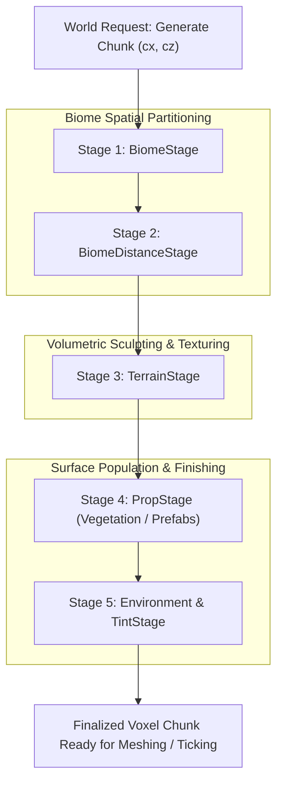

# Hytale WorldGen V2: The Staged Chunk Generation Pipeline

## 1. Architectural Overview

At the heart of Hytale's WorldGen V2 engine lies the **`StagedChunkGenerator`** (originally developed as `NStagedChunkGenerator` under `com.hypixel.hytale.builtin.hytalegenerator.engine.chunkgenerator`). 

Unlike monolithic generation algorithms that generate terrain, caves, blocks, and trees in a single nested loop or disorganized passes, V2 employs a **strictly decoupled, multi-stage pipeline**. Each stage has deterministic inputs, produces isolated outputs, and runs with fine-grained caching and parallel execution guarantees.



---

## 2. Stage Breakdown & Execution Lifecycle

### Stage 1: `BiomeStage`
* **Package:** `com.hypixel.hytale.builtin.hytalegenerator.engine.chunkgenerator.stages`
* **Input:** Horizontal chunk coordinates $(cx, cz)$ and the world seed.
* **Core Responsibilities:**
  1. Queries the macro `WorldStructure` and the underlying cell map (`BiCarta<Integer>`).
  2. Resolves which `TileBiome` and optional `CustomBiome` overrides govern each horizontal coordinate $(x, z)$ within the chunk volume ($32 \times 32$ or $16 \times 16$ grid).
  3. Establishes the local biome assignment array.
* **Performance Characteristic:** Highly cacheable. Biome cells are evaluated at low horizontal resolution (e.g., $4 \times 4$ blocks) and smoothly queried.

---

### Stage 2: `BiomeDistanceStage`
* **Core Responsibilities:**
  1. For every horizontal coordinate $(x, z)$, calculates the shortest Euclidean distance to adjacent biome boundaries.
  2. Evaluates the normalized transition factor $T \in [0.0, 1.0]$:
     $$T = \text{clamp}\left(\frac{\text{dist}(\mathbf{p}, \partial B)}{\text{DefaultTransitionDistance}}, 0, 1\right)$$
  3. Pre-computes weight matrices for multi-biome interpolation. If a coordinate sits within the blend corridor of two or more biomes, the distance weights are normalized:
     $$\sum_{i=1}^{k} w_i = 1.0$$
* **Why This Matters:** In V1 (and traditional voxel engines), biome blending is handled crudely by averaging temperature/humidity noise or hard clipping. In V2, `BiomeDistanceStage` provides a mathematically continuous distance field that terrain density and material shaders sample directly.

---

### Stage 3: `TerrainStage`
* **Core Responsibilities:**
  1. **Volumetric Density Evaluation:** Executes the 3D density function graph defined by the active biome(s).
  2. **Isosurface Sampling:** For every voxel coordinate $(x, y, z)$, evaluates the composite density value $D(x, y, z)$.
     * $D(x, y, z) > 0$: **Solid matter** (stone, dirt, bedrock).
     * $D(x, y, z) < 0$: **Negative space** (atmosphere, cave caverns, tunnels).
     * $D(x, y, z) = 0$: **The Isosurface** (exact terrain boundary).
  3. **Vertical Sub-Sampling Optimization (`YSampled`):** 
     Evaluating arbitrary 3D noise at every block across a 384-block height range is computationally prohibitive ($16 \times 16 \times 384 = 98,304$ samples per chunk).
     V2 samples full density functions at vertical step intervals (e.g., every 4 or 8 blocks along the Y axis) and applies trilinear Hermite/spline interpolation between samples for intermediate blocks, retaining full detail with an ~85% reduction in sampling overhead.
  4. **Material Provider Execution:** Converts raw solid/empty density flags into concrete voxel block types using surface, wall, ceiling, and depth rules.

---

### Stage 4: `PropStage` (Surface Populators & Prefabs)
* **Core Responsibilities:**
  1. Identifies valid placement candidate surfaces (grass tops, cave ceilings, cliff ledges, water beds).
  2. Executes single-pass prop generators (`generate(Prop.Context)`):
     * Flora & scatter: Grass blades, flowers, bushes, small boulders.
     * Trees: Procedural tree generators and multi-part canopy structures.
     * Prefabs: Dungeons, ruins, campsites, and architectural points of interest.
  3. Performs collision checks, attachment validation (sockets), and rotational alignment relative to surface normal vectors.

---

### Stage 5: `EnvironmentStage` & `TintStage`
* **Core Responsibilities:**
  1. Calculates liquid body fills (oceans, rivers, aquifers, lava pools).
  2. Injects localized atmospheric parameters:
     * Sky and fog color gradients.
     * Water absorption and surface tinting.
     * Foliage and grass tint modifiers based on biome palettes.
  3. Pre-calculates initial skylight and blocklight attenuation nibbles.

---

## 3. Memory Spaces: `materialReadSpace` vs `materialWriteSpace`

A major innovation in Hytale's chunk generator design is the strict separation between read-only reference data and writable voxel buffers:

```
┌─────────────────────────────────────────────────────────┐
│               Staged Chunk Execution Context            │
├───────────────────────────┬─────────────────────────────┤
│     materialReadSpace     │     materialWriteSpace      │
│  (Read-Only Neighborhood) │    (Current Target Chunk)   │
├───────────────────────────┼─────────────────────────────┤
│ • 3x3 Chunk Neighborhood  │ • Isolated Local Voxel Grid │
│ • Surface Normal Queries  │ • Fast Primitive Write Array│
│ • Proximity Collision     │ • Lock-Free Single Writer   │
│ • Safe Parallel Sampling  │ • Thread-Safe Buffer Pool   │
└───────────────────────────┴─────────────────────────────┘
```

### Design Rationale:
1. **Zero Race Conditions:** During `PropStage` or `TerrainStage`, reading adjacent blocks (e.g., checking if a tree branch extends into a neighboring chunk) queries `materialReadSpace`.
2. **Buffer Pooling & Zero Allocation:** `materialWriteSpace` uses pre-allocated off-heap or pooled primitive arrays (`short[]` or `int[]` block state IDs). Chunks do not allocate GC-heavy wrapper objects during stage evaluation.
3. **Pipelined Asynchrony:** Chunk generation tasks can run across all available CPU cores without synchronized mutex locks on block arrays.

---

## 4. Multi-Threading & Asynchronous Chunk Streaming

The `StagedChunkGenerator` is designed for high-concurrency environments:

* **Stage Dependencies as DAG:** Each chunk advances through stages governed by a Directed Acyclic Graph (DAG).
* **Chunk Neighborhood Window:**
  * To run `TerrainStage` on chunk $(x, z)$, `BiomeStage` must have completed for the surrounding $(3 \times 3)$ neighborhood.
  * To run `PropStage` (which may spill structures across borders), `TerrainStage` must be finalized in the immediate neighborhood.
* **Worker Thread Pools:** Work is queued into thread-safe priority work-stealing pools. Chunks near player view radii receive highest priority, while background generation runs throttled.

---

## 5. Architectural Alignment with Minecraft 26.1

In Minecraft Java Edition (specifically deobfuscated 26.1), world generation is implemented inside `ChunkGenerator` and `NoiseBasedChunkGenerator`, coordinating through `ChunkAccess` and `LevelChunkSection`.

By wrapping Hytale V2's `StagedChunkGenerator`:
1. `BiomeStage` maps directly to Minecraft's `BiomeSource`.
2. `TerrainStage` replaces Minecraft's `NoiseChunk` and `SurfaceRules` with the superior V2 node-evaluated volumetric density field and `SpaceAndDepth` material provider pipeline.
3. `PropStage` executes ahead of Minecraft's slower multi-step `Feature` pipeline, guaranteeing perfect structural alignment with Hytale prefabs and vegetation.
