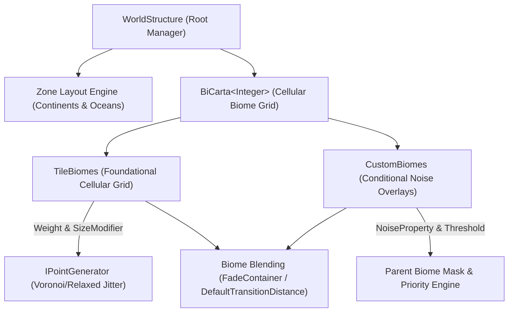

# Hytale WorldGen V2: Macro World & Biome Architecture

## 1. Overview of Macro World Partitioning

Hytale's world generation operates on two distinct hierarchical tiers:
1. **The Macro Zone Tier:** Broad narrative continents or climatic regions (e.g., Zone 1: *Emerald Grove*, Zone 2: *Howling Sands*, Zone 3: *Boreal Tundra*, Zone 4: *Devastated Lands*, Ocean Zones).
2. **The Biome Cell Tier:** The localized environmental biomes nested within each Zone, governing actual terrain geometry, foliage, materials, and creature spawns.

In WorldGen V2, the legacy `BiomeMap` and `SimpleBiomeMap` classes were deprecated and replaced by **`WorldStructure`** under `com.hypixel.hytale.builtin.hytalegenerator.engine.worldstructure`. 



---

## 2. The `WorldStructure` & `BiCarta<Integer>` System

### 2.1 What is `BiCarta<Integer>`?
`BiCarta` (literally "Two Maps" or a dual-coordinate partitioned raster/graph) is Hytale V2's internal data structure for fast spatial queries of biome indices:
* It maps infinite 2D world coordinates $(x, z)$ to an integer registry ID representing the assigned biome:
  $$\text{biomeId} = \text{BiCarta.get}(x, z)$$
* Instead of evaluating noisy multi-octave math for every individual block, `BiCarta` computes and caches cell polygons at low spatial granularity (typically partitioned into $16 \times 16$ or $32 \times 32$ world-unit tiles).
* It provides $O(1)$ lookups for biome membership, neighbor adjacencies, and distances to the nearest cell boundary.

---

## 3. TileBiomes vs. CustomBiomes

A fundamental design breakthrough in Hytale V2 is the division of biomes into two distinct functional categories: **`TileBiomes`** and **`CustomBiomes`**.

### 3.1 `TileBiomes` (`TileBiome`)
`TileBiomes` form the continuous, gapless foundation of the world. They tessellate the continent like a Voronoi diagram or patchwork quilt.

* **Key Properties:**
  * **`weight` (float):** The relative statistical probability of this biome being chosen when seeding a new cellular point. Higher weight means the biome occurs more frequently across the zone.
  * **`sizeModifier` (float):** The radius/scale multiplier of the biome cell. A biome with `sizeModifier: 2.0` claims roughly double the spatial diameter of a standard biome (`sizeModifier: 1.0`).
  * **`biomeId` (int / ResourceLocation):** Unique identifier registered in `Registry<Biome>`.

* **The Generation Algorithm:**
  1. The Zone is seeded using an **`IPointGenerator`** (such as Poisson Disc sampling, jittered grid, or Lloyd-relaxed Voronoi).
  2. Each generated point is assigned a `TileBiome` based on weighted lottery selection.
  3. Voronoi cell boundaries are computed using a distance metric (typically Manhattan, Euclidean, or Chebyshev with noise perturbation).

```
Visualizing TileBiome Tessellation:
┌─────────────────┬───────────────────────┐
│                 │                       │
│   TileBiome A   │      TileBiome B      │
│  (Weight: 10,   │     (Weight: 20,      │
│  SizeMod: 1.0)  │     SizeMod: 2.5)     │
│                 │                       │
├─────────────────┼───────────────────────┤
│                 │                       │
│   TileBiome C   │      TileBiome D      │
│                 │                       │
└─────────────────┴───────────────────────┘
```

---

### 3.2 `CustomBiomes` (`CustomBiome` / `CustomBiomeGenerator`)
While `TileBiomes` provide stable continental tiling, naturally occurring worlds require specialized sub-biomes, rare micro-climates, oasis formations, volcanic craters, and river corridors that should *not* follow rigid Voronoi cell boundaries.

Enter **`CustomBiomes`**: conditional override biomes that dynamically inject themselves over `TileBiomes`.

* **Key Mechanisms:**
  1. **`Parent Biome Mask`:** Specifies a whitelist of `TileBiomes` where this custom biome is allowed to manifest. For example, an *Oasis* custom biome can only generate if its parent is *Desert Dunes*.
  2. **`NoiseProperty` & `IDoubleThreshold`:** Defines continuous 2D mathematical fields (e.g., ridged multifractal noise or distance gradients). If the sampled noise value falls within `[thresholdMin, thresholdMax]`, the custom biome activates.
  3. **`getPriority()` (int):** When multiple custom biomes satisfy their conditions at the same $(x, z)$ coordinate, the one with the highest priority wins.
  4. **`FadeContainer` & `FadeDistance`:** Controls how the edges of the custom biome fade smoothly into the underlying parent tile biome.

```
Visualizing CustomBiome Override:
┌─────────────────────────────────────────┐
│ TileBiome: Plains                       │
│                                         │
│       ╭─────────────────────╮           │
│       │ CustomBiome:        │           │
│       │ Whispering Grove    │           │
│       │ (Threshold > 0.65,  │           │
│       │  Priority: 10)      │           │
│       ╰─────────────────────╯           │
│                                         │
└─────────────────────────────────────────┘
```

---

## 4. Mathematical Biome Blending & Transition Corridors

In WorldGen V2, adjacent biomes never produce harsh cliff cuts or block-type shearing. This is governed by the **`DefaultTransitionDistance`** and the **`FadeContainer`**.

### 4.1 Boundary Distance Calculation
For any world position $\mathbf{p} = (x, z)$, let:
* $B_0$ be the primary biome assigned to $\mathbf{p}$.
* $B_1, B_2, \dots, B_k$ be adjacent neighboring biomes.
* $d_i$ be the Euclidean distance from $\mathbf{p}$ to the boundary of neighbor $B_i$.
* $R_T$ be the transition corridor width (`DefaultTransitionDistance`, typically 32 to 64 blocks).

The transition factor $w_i$ for each neighboring biome is calculated via smooth Hermite interpolation:

$$t = \text{clamp}\left(\frac{R_T - d_i}{R_T}, 0.0, 1.0\right)$$
$$S(t) = 3t^2 - 2t^3 \quad \text{(Smoothstep)}$$

### 4.2 Interpolation of Terrain & Material Properties
When evaluating density $D(\mathbf{p}, y)$ inside a transition corridor:
$$D_{\text{final}}(\mathbf{p}, y) = (1 - \sum w_i) D_{B_0}(\mathbf{p}, y) + \sum_{i=1}^{k} w_i D_{B_i}(\mathbf{p}, y)$$

This ensures that:
* Height baselines transition smoothly across rolling curves.
* Mountain density slopes ease into flatlands without vertical walls.
* Surface materials (grass $\to$ sand $\to$ gravel) blend organically.

---

## 5. Architectural Blueprint for Minecraft 26.1

To recreate this in Minecraft Java 26.1:

1. **Custom `BiomeSource`:** Implement a high-performance `HytaleBiomeSource` replacing Minecraft's `MultiNoiseBiomeSource`.
2. **Fast Voronoi Engine:** Implement a fast SIMD-friendly cellular point generator utilizing Java 25 Vector API or primitive spatial hashing.
3. **Dual Map Registry:**
   * Maintain a registry for `TileBiome` entries.
   * Maintain an ordered list of `CustomBiome` evaluators executed on top of base tile queries.
4. **Distance Field Cache:** Cache pre-calculated distance vectors for chunk columns so that `TerrainStage` can blend noise functions at maximum FPS.
