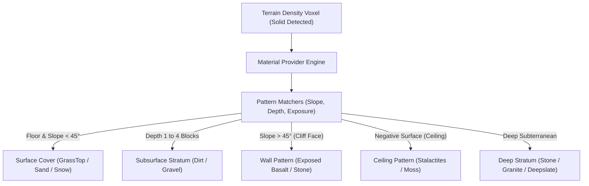

# Hytale WorldGen V2: Material Providers & The Structural Pattern Engine

## 1. Architectural Overview

Once the 3D density field defines where solid matter exists, the **Material System** is tasked with answering: *Which physical block type occupies each solid coordinate?*

In Hytale WorldGen V2, block assignment is governed by two tightly coupled subsystems:
1. **Material Providers (`materialproviders`):** Procedural generators that emit block materials based on environmental depth, noise, and stratification.
2. **Structural Patterns (`patterns`):** Conditional geometric matchers that evaluate spatial orientation, surface slope angles, ceiling vs floor relationships, and material proximities.



---

## 2. Core Material Providers

All material providers reside in the package `com.hypixel.hytale.builtin.hytalegenerator.materialproviders`.

### 2.1 Foundational Material Classes

* **`SolidMaterial` & `FluidMaterial`:**
  * Define whether a voxel represents rigid collidable mass or free-flowing hydrostatic volumes (water, lava, swamp muck).
  * Hold native block state identifiers, collision flags, and physical drag coefficients.

* **`ConstantMaterialProvider`:**
  * Returns an invariant block state (e.g., `minecraft:stone` or `hytale:granite`) for all queried coordinates.
  * Used as default bedrock baselines or uniform mantle fillings.

* **`WeightedMaterialProvider`:**
  * Selects among a collection of block types according to statistical weights:
    $$\{ \text{stone}: 80\%, \text{andesite}: 15\%, \text{gravel}: 5\% \}$$
  * Uses deterministic spatial hashing based on coordinate bit-mixing to prevent visual noise artifacts while remaining purely stateless.

* **`QueueMaterialProvider` (Priority Fallback):**
  * Evaluates a sequence of material providers with condition guards. The first provider whose conditions evaluate to `true` provides the block; if none match, falls back to a default provider.

---

### 2.2 Stratification & Layering: The `SpaceAndDepth` System

A signature capability of Hytale V2 is the **`SpaceAndDepth`** material engine. Natural geology is stratified like a cake: topsoil rests on clay, clay rests on fractured shale, and shale rests on massive granite.

`SpaceAndDepth` evaluates:
1. **`depth` (int):** The distance in blocks from the voxel to the nearest surface exposed to air (or fluid).
2. **`space` (int):** The height of unobstructed air/fluid space existing above the surface.

```
Visualizing SpaceAndDepth Stratification:
            Unobstructed Air (space >= 5)
                      ▲
                      │
══════════════════════╪══════════════════════ Depth = 0 (Surface Exposed to Air)
 Layer 0: Grass Top   │ (1 block thick)
──────────────────────┼────────────────────── Depth = 1
 Layer 1: Fine Dirt   │ (3-4 blocks thick)
──────────────────────┼────────────────────── Depth = 5
 Layer 2: Fractured   │ (8-12 blocks thick)
          Sediment    │
──────────────────────┼────────────────────── Depth = 15
 Layer 3: Bedrock     │ (Infinite base stone)
          Massif      │
```

#### Air Space Gating:
If `space < 3` (e.g., inside a narrow 2-block crevice or low cave crawlspace), `SpaceAndDepth` suppresses grass generation and places coarse dirt or damp gravel instead, ensuring grass never generates unnaturally inside dark claustrophobic cracks.

---

## 3. The Structural Pattern Engine (`patterns`)

Under `com.hypixel.hytale.builtin.hytalegenerator.patterns`, Hytale V2 introduces a rich grammar of geometric pattern matchers. These patterns allow designers to express complex real-world geological conditions in declarative node graphs.

### 3.1 Geometric & Orientation Patterns

| Pattern Class | Condition Evaluated | Practical Application |
| :--- | :--- | :--- |
| **`SurfacePattern`** | Voxel has at least one neighboring face adjacent to air/fluid along $+Y$. | Top-layer coverage (grass, snow, desert dunes, underwater silt). |
| **`WallPattern`** | Voxel has horizontal faces adjacent to air/fluid ($\pm X, \pm Z$). | Cliff faces, canyon walls, sheer stone bluffs. |
| **`CeilingPattern`** | Voxel has neighboring face adjacent to air along $-Y$. | Cave roofs, arch undersides, stalactites, hanging moss. |
| **`CuboidPattern`** | Voxel coordinates fall within explicit bounding box $[x_1, y_1, z_1] \to [x_2, y_2, z_2]$. | Regional strata layers, height-banded geological deposits. |
| **`GapPattern`** | Evaluates minimum void distance between opposite surfaces. | Narrow canyon detection, crevasse filling. |
| **`OffsetPattern`** | Tests another pattern at an offset coordinate $(x + \Delta x, y + \Delta y, z + \Delta z)$. | Proximity queries, checking what lies beneath or above. |

---

### 3.2 Logical Combinator Patterns

* **`AndPattern`:** Conjunction ($P_1 \land P_2$). Both conditions must be satisfied (e.g., `SurfacePattern` AND `Slope < 30°`).
* **`OrPattern`:** Disjunction ($P_1 \lor P_2$). Either condition is satisfied.
* **`NotPattern`:** Negation ($\neg P$). Inverts the condition (e.g., NOT `WallPattern`).

---

### 3.3 Dynamic Slope Detection & Normal Estimation
To distinguish between lush grass meadows and rugged cliff faces, `SurfacePattern` computes the **surface gradient normal vector** $\mathbf{N} = (n_x, n_y, n_z)$ from the density field:

$$\mathbf{N} = -\nabla D = -\left( \frac{\partial D}{\partial x}, \frac{\partial D}{\partial y}, \frac{\partial D}{\partial z} \right)$$
$$\text{Slope Angle } \theta = \arccos\left(\frac{n_y}{\|\mathbf{N}\|}\right)$$

* **$\theta < 35^\circ$:** Gentle slope $\to$ Lush Grass and Flowers.
* **$35^\circ \le \theta < 60^\circ$:** Steep grade $\to$ Coarse Dirt, Mossy Stone, Scree.
* **$\theta \ge 60^\circ$:** Sheer vertical wall $\to$ Exposed Bedrock, Striated Basalt.

---

## 4. Comparison: Hytale V2 Material Engine vs. Minecraft SurfaceRules

Minecraft 1.18+ introduced `SurfaceRules` using a sequence of `RuleSource` JSON objects (`conditionSource`, `band_offset`, `stone_depth_ceiling`, etc.). While powerful, Minecraft's system suffers from several critical architectural limitations compared to Hytale V2:

| Capability | Minecraft `SurfaceRules` | Hytale V2 Material Engine |
| :--- | :--- | :--- |
| **Evaluation Model** | Top-down 1D depth ray marching per column | Full 3D volumetric pattern matching |
| **Slope Awareness** | Coarse estimation via height offsets | Continuous vector gradient normal ($\nabla D$) |
| **Overhang Texturing** | Struggles with multi-tier overhangs | Native: each overhang has independent ceiling and floor |
| **Cave Ceilings** | Primitive ceiling rule source | Explicit `CeilingPattern` with clearance space checks |
| **Modularity & Speed** | Highly nested AST with heavy Java object overhead | Flattened bytecode-compiled or primitive array matchers |
| **Designer Tooling** | Hand-edited massive JSON data packs | Visual interactive node graph with live reload |

---

## 5. Architectural Blueprint for Minecraft 26.1

To bring this material engine to Minecraft 26.1:

1. **`VoxelMaterialSpace` Wrapper:** Construct a high-performance voxel buffer that wraps Minecraft's `LevelChunkSection` array (`PalettedContainer<BlockState>`).
2. **Compiled Pattern Matchers:** Implement pattern evaluators using bitmasks and fast primitive lookups.
3. **Normal Vector Calculation:** Provide an optimized central-difference gradient evaluator on the density field:
   $$\frac{\partial D}{\partial x} \approx \frac{D(x+1, y, z) - D(x-1, y, z)}{2}$$
4. **Integration Hook:** Replace vanilla Minecraft's `SurfaceSystem.buildSurface` call with our `HytaleMaterialPipeline.execute(chunk)`.
