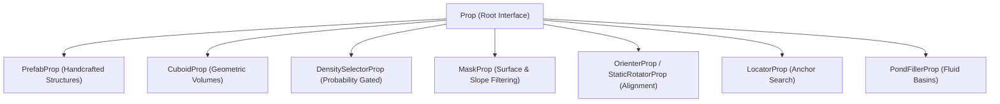

# Hytale WorldGen V2: Prop System & Prefab Distribution Engine

## 1. Architectural Evolution: The Prop Revolution

In earlier iterations (including Hytale V1 and the deprecated V3 experimental branch), world decoration was managed via a cumbersome **two-phase pipeline**:
1. **The `scan()` Phase:** The engine marched across chunk blocks looking for surface patterns, allocating candidate anchor coordinates.
2. **The `place()` Phase:** A second pass iterated over candidate lists, checking collisions and stamping blocks.

This two-phase approach suffered from severe cache thrashing, intermediate memory allocations, and complex inter-chunk synchronization issues.

In WorldGen V2 (promoted and finalized in recent engine updates), this entire pipeline was discarded in favor of a **streamlined, single-pass generation contract**:

```java
public interface Prop {
    /**
     * Single-pass contextual generation.
     * Evaluates placement logic, collision constraints, and block stamping in one unified pass.
     * 
     * @param context Immutable generation context containing material spaces, coordinates, and RNG
     * @return true if the prop was successfully placed, false if placement aborted
     */
    boolean generate(Prop.Context context);
}
```

---

## 2. The Built-in Prop Hierarchy

Under `com.hypixel.hytale.builtin.hytalegenerator.props`, V2 provides a modular suite of composable prop primitives:



### Detailed Component Specifications

| Prop Type | Primary Function | Algorithmic Mechanism |
| :--- | :--- | :--- |
| **`PrefabProp`** | Stamping handcrafted buildings, ruins, trees, dungeons. | Reads serialized prefab voxel models (`.prefab`), checks bounding box collisions, and commits blocks to `materialWriteSpace`. |
| **`DensitySelectorProp`** | Density-driven probabilistic distribution. | Evaluates a density function or noise field; prop spawns only if sampled value $V \ge \text{threshold}$, modulating cluster density. |
| **`MaskProp`** | Condition gating and surface classification. | Ensures prop only spawns on valid underlying blocks (e.g., grass or sand) and rejects steep cliff slopes or submerged beds. |
| **`LocatorProp`** | Vertical anchor scanning. | Efficiently traces along the $Y$ column within a specified $[y_{\min}, y_{\max}]$ window to find valid surface or ceiling contact. |
| **`OrienterProp`** | Normal-aligned rotational stamping. | Aligns the prop's up-vector $(0, 1, 0)$ to the terrain surface normal $\mathbf{N} = -\nabla D$, allowing trees or bushes to grow perpendicular to hillsides. |
| **`StaticRotatorProp`** | Cardinal or discrete rotational variations. | Applies randomized $90^\circ$, $180^\circ$, or $270^\circ$ yaw rotations to eliminate repetitive orientation patterns across prefabs. |
| **`CuboidProp`** | Generates procedural cuboid stone pillars or foundation plinths. | Fills volumetric bounding regions with customizable edge bevels or noise distortion. |
| **`PondFillerProp`** | Carves depression basins and fills with fluids. | Detects concave surface depressions, replaces ground with gravel/clay, and fills with water up to a hydrostatic baseline. |

---

## 3. The Prefab Socket & Attachment System

One of Hytale's most famous world generation capabilities is its procedural dungeon and structure assembly via **Sockets** and **Attachment Points**.

### 3.1 Architectural Modular Assembly
Instead of stamping static, monolithic structures (like vanilla Minecraft villages or desert temples), Hytale structures are modular assemblies:

```
Procedural Prefab Socket Assembly:
┌──────────────────────────────────────────────┐
│             Entrance Gatehouse               │
│               [Socket: SOUTH]                │
└──────────────────────┬───────────────────────┘
                       │ Connected via Socket
┌──────────────────────┴───────────────────────┐
│              Central Courtyard               │
│ [Socket: WEST]                [Socket: EAST] │
└──────┬───────────────────────────────┬───────┘
       │                               │
┌──────┴──────────────┐ ┌──────────────┴───────┐
│   Barracks Wing     │ │     Armory Wing      │
│  [Socket: NORTH]    │ │   [Socket: NORTH]    │
└─────────────────────┘ └──────────────────────┘
```

1. **Attachment Markers (Sockets):** Prefab models contain metadata metadata voxels (sockets) defining attachment type, gender (male/female or plug/socket), and allowable rotation.
2. **Contextual Fitting:** When placing a dungeon entrance on the surface, the engine queries compatible subterranean corridor segments from its registry and recurses downward.
3. **Collision Bounding Octrees:** Before an attachment is committed to `materialWriteSpace`, its Axis-Aligned Bounding Box (AABB) is tested against existing structures in the chunk cluster to eliminate overlapping walls.
4. **Adaptive Foundations:** Sockets that contact uneven terrain generate procedural foundation pillars (stone plinths) extending downward into solid ground, preventing buildings from floating over ravines.

---

## 4. Density-Driven Prop Placement (Natural Scatter)

Traditional voxel engines distribute flora by rolling a dice uniformly across every surface block (e.g., "10% chance of a dandelion"). This produces an unnatural, homogeneous "confetti" appearance.

Hytale WorldGen V2 uses **Density-Driven Clustering**:

$$\text{Probability } P(x, z) = \text{clamp}\left(N_{\text{scatter}}(x \cdot f, z \cdot f) \cdot A_{\text{biome}} - T, 0.0, 1.0\right)$$

* **$N_{\text{scatter}}$:** Low-frequency simplex or Worley cellular noise.
* **$A_{\text{biome}}$:** Biome density multiplier.
* **$T$:** Sparsity threshold.

### Visual Result:
* Trees gather in dense, natural groves with sunny clearings in between.
* Flowers form blooming patches of poppies and lavender rather than isolated single stems.
* Rocks and fallen logs cluster naturally along riverbanks and mountain scree slopes.

---

## 5. Comparison: Hytale V2 Props vs. Minecraft Features

| Generation Phase | Minecraft 26.1 `PlacedFeature` | Hytale V2 Prop Engine |
| :--- | :--- | :--- |
| **Execution Phase** | Multi-step feature decorators (`count`, `in_square`, `heightmap`, `biome`) | Single-pass unified `generate(Prop.Context)` |
| **Slope / Normal Tracking** | Blind to surface slope; stamps vertically on heightmap | Normal-aware; aligns geometry to surface gradient |
| **Subsurface Awareness** | Top-down heightmap query only | Full 3D contact detection (cave ceilings, overhangs, walls) |
| **Structure Modularity** | Rigid Jigsaw pattern system with fixed templates | High-speed dynamic socket graphs with procedural plinths |
| **Performance Overhead** | Heavy allocation of intermediate `Stream` and `BlockPos` objects | Primitive integer contexts and direct buffer writes |

---

## 6. Implementation Blueprint for Minecraft 26.1

To implement this prop engine in Minecraft 26.1:

1. **Lightweight Context Interface:**
   ```java
   public record PropContext(
       ChunkAccess chunk,
       int localX, int worldY, int localZ,
       HytaleDensityField densityField,
       Vector3f surfaceNormal,
       RandomSource random
   ) {}
   ```
2. **Fast Prefab Format (.schem / .nbt / .v2prefab):** Create an ultra-compact binary format for prefabs that can be unpacked directly into Minecraft's `LevelChunkSection` palette without intermediate entity parsing.
3. **Socket Resolver Engine:** Implement a fast BFS/DFS room connector that expands subterranean dungeon complexes across chunk boundaries safely.
