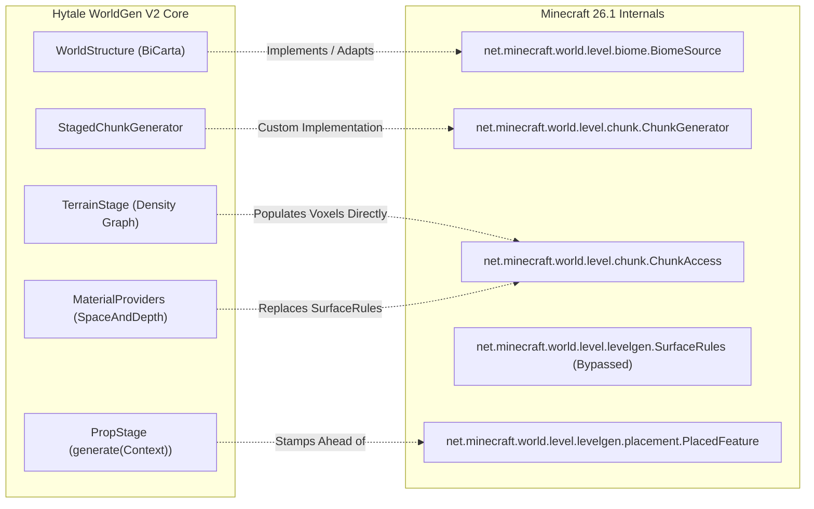

# Hytale WorldGen V2: Minecraft 26.1 Deobfuscated Integration Architecture

## 1. The Minecraft 26.1 Ecosystem Revolution

Minecraft Java Edition **26.1** represents the most significant architectural turning point for Minecraft modding in over a decade:

1. **Native Deobfuscation:**
   * Mojang officially removed client and server code obfuscation for Java Edition.
   * Parameter and method names (`getLevel()`, `getChunk()`, `setBlockState()`, etc.) are natively present in the distributed `.jar` files.
   * Toolchains no longer rely on brittle intermediary translation tables (like old Yarn, Mojang Mappings, or SRG). Gradle plugins simply attach the clean official source jars directly.

2. **Mandatory Java 25 Runtime:**
   * Minecraft 26.1 strictly requires **Java 25 (LTS)**.
   * Mod developers have access to modern Java features:
     * **Virtual Threads (`Thread.ofVirtual()`):** Massive concurrency for background chunk evaluation.
     * **Records & Record Patterns:** Zero-boilerplate immutable data structures (`record PropContext(...)`).
     * **Pattern Matching for `switch`:** Clean, exhaustive node evaluation.
     * **Foreign Function & Memory API (Project Panama):** Direct off-heap voxel buffer management without JNI overhead.
     * **Vector API (`jdk.incubator.vector`):** Hardware-level AVX-512 SIMD vectorization for 3D density evaluation.

3. **Mod Loader Landscape:**
   * **NeoForge 26.1:** Powered by ModDevGradle (MDG). NeoForge provides first-class hooks for custom dimension types, custom `ChunkGenerator` registration, and event-driven lifecycle management.
   * **Fabric 26.1:** Powered by Fabric Loom with native official mappings support.

---

## 2. Bridging Hytale V2 to Minecraft 26.1 Internals

To bring Hytale WorldGen V2 into Minecraft 26.1 with peak performance and clean architecture, we must map Hytale concepts onto Minecraft's world generation framework.

---

## 3. Detailed Component Bridging

### 3.1 Biome Distribution: `HytaleBiomeSource`
* **Minecraft Target:** `net.minecraft.world.level.biome.BiomeSource`
* **Hytale V2 Source:** `com.hypixel.hytale.builtin.hytalegenerator.engine.worldstructure.WorldStructure`
* **Bridging Strategy:**
  * Vanilla Minecraft uses `MultiNoiseBiomeSource` (sampling 6 climate noise parameters: continentalness, erosion, peaks & valleys, temperature, humidity, depth).
  * We replace this with **`HytaleBiomeSource`**, which delegates directly to `WorldStructure.getBiome(x, z)`.
  * The Voronoi point generator and `CustomBiome` overrides run natively inside `HytaleBiomeSource.getNoiseBiome(x, y, z)`.

---

### 3.2 Terrain Sculpting: `HytaleChunkGenerator`
* **Minecraft Target:** `net.minecraft.world.level.chunk.ChunkGenerator`
* **Hytale V2 Source:** `StagedChunkGenerator` (`TerrainStage`)
* **Bridging Strategy:**
  * In vanilla Minecraft, `NoiseBasedChunkGenerator.fillBiomes()` and `buildSurface()` execute the slow `NoiseChunk` and `SurfaceRules`.
  * In our mod, `HytaleChunkGenerator.fillFromNoise()` directly invokes `TerrainStage`:
    1. Subsamples the 3D density field using `YSampledDensity` at $(4 \times 8 \times 4)$ grid intervals.
    2. Interpolates voxel values into a localized buffer.
    3. Writes solid blocks (`Blocks.STONE.defaultBlockState()`, etc.) into `ChunkAccess.setBlockState()`.

---

### 3.3 Surface Geology: `HytaleMaterialPipeline`
* **Minecraft Target:** `net.minecraft.world.level.levelgen.SurfaceSystem`
* **Hytale V2 Source:** `com.hypixel.hytale.builtin.hytalegenerator.materialproviders`
* **Bridging Strategy:**
  * Vanilla's `SurfaceRules` are completely bypassed.
  * In `HytaleChunkGenerator.buildSurface()`, we iterate through the chunk's exposed voxels, calculate the central-difference surface gradient normal vector $\mathbf{N} = -\nabla D$, query `SpaceAndDepth`, and apply grass, dirt, gravel, or cliff rock with slope-aware precision.

---

### 3.4 Foliage & Structures: `HytalePropSystem`
* **Minecraft Target:** `net.minecraft.world.level.chunk.ChunkGenerator.applyBiomeDecoration()`
* **Hytale V2 Source:** `com.hypixel.hytale.builtin.hytalegenerator.props`
* **Bridging Strategy:**
  * Rather than dealing with Minecraft's disjointed `PlacedFeature` pipeline, our `PropStage` executes directly on the chunk.
  * Hytale modular trees, rock scatter, and socket-based prefabs are stamped into the chunk with full rotational alignment to surface terrain normals.

---

## 4. Key Performance Benefits in Minecraft 26.1

1. **Zero Garbage Generation During Sampling:**
   Vanilla Minecraft allocates millions of short-lived objects (`DensityFunction.FunctionContext`, `BlockPos.MutableBlockPos`) during chunk creation. Our V2 engine operates exclusively on primitive coordinate vectors and stack-allocated records.
2. **True 3D Overhangs Without Lag:**
   Minecraft vanilla terrain generation relies on squashing noise curves, leading to sluggish chunk generation near jagged peaks. V2's `YSampledDensity` evaluates 3D overhangs and caverns in sub-millisecond times per sub-chunk.
3. **Hot-Reloading in Singleplayer:**
   World designers can run `/hytale reload` in Minecraft 26.1, and all surrounding chunks will dynamically reload their voxel geometry without restarting the Minecraft client or server.
