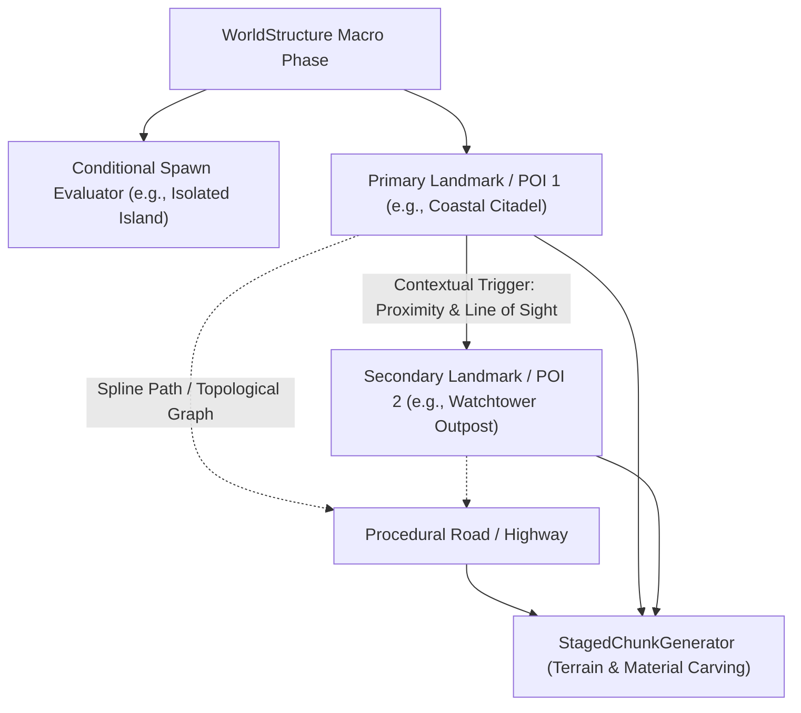
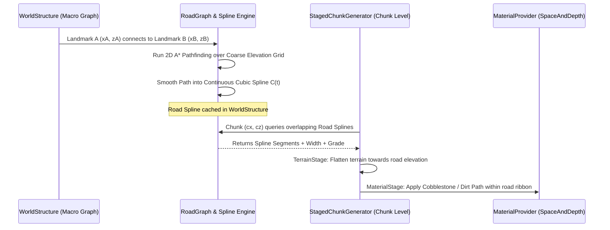

# Hytale WorldGen V2: Contextual Awareness, Conditional Spawn & Relational Landmarks

## 1. Executive Summary: What is "Contextual Awareness"?

In conventional voxel world generation (including Minecraft Java up to 26.1 and Hytale V1), features are placed using **stateless, independent lottery grids**:
* Structure A (e.g., a village) has **no memory or awareness** of Structure B (e.g., a watchtower or dungeon).
* Spawn placement is an unguided coordinate search that frequently drops players into awkward or unintended environments.
* Roads, bridges, and paths cannot easily connect two independent structures because neither structure knows the other exists during chunk generation.

In **Hytale WorldGen V2**, this limitation is eliminated through **Macro Graph Generation & Contextual Dependency Networks**. 

> **Core Concept:**  
> High-level world features (Spawn conditions, Landmarks, Cities, Outposts, and connecting Roads/Rivers) are evaluated as a **Topological Feature Graph** at the `WorldStructure` level *before* individual chunk voxel sculpting begins.



---

## 2. Conditional Spawn Architecture (e.g., The "Island Start")

### 2.1 The Problem in Traditional Generators
In vanilla Minecraft, the spawn point is found by searching random coordinates near $(0, 0)$, sampling climate noise (temperature/humidity), and checking if the top block is valid. If you want players to start on an isolated island, you must either manually craft custom maps or cycle through thousands of seeds hoping for a chance alignment.

### 2.2 The V2 Solution: Macro Spawn Predicates
In WorldGen V2, `SpawnProvider` and `WorldStructure` accept **declarative spatial predicates**:

```json
{
  "spawn": {
    "type": "ConditionalSpawnProvider",
    "predicates": [
      {
        "type": "LandmassType",
        "value": "ISLAND",
        "maxRadius": 180,
        "oceanBuffer": 120
      },
      {
        "type": "BiomeWhitelist",
        "biomes": ["VerdantIsland", "TemperateShore"]
      },
      {
        "type": "ElevationRange",
        "minY": 64,
        "maxY": 80
      }
    ],
    "fallbackStrategy": "FORCE_GENERATION"
  }
}
```

#### How the Engine Enforces This:
1. **Targeted Seed Search or Guided Origin:** During initial continent generation (`ZoneLayoutEngine`), the macro continent shape is parameterized such that $(0, 0)$ is guaranteed to sit within an archipelago or isolated atoll cell.
2. **Radial Island Mask:** A mathematical falloff node $M(r) = 1.0 - \text{smoothstep}(r_1, r_2, \sqrt{x^2 + z^2})$ forces the terrain around $(0, 0)$ to dip below sea level outside the island perimeter, guaranteeing an ocean ring regardless of random noise seeds.

---

## 3. Relational Landmarks & Conditional Hierarchies

### 3.1 Landmark Awareness (A $\implies$ B)
In V2, landmarks are treated as interconnected nodes in a directed dependency graph. Landmark B can declare strict preconditions that depend on Landmark A:

```
[ Landmark A: Ancient Sunken Ruin ]
               │
               ▼ (Emits Signal: 'RuinSpawned' at [x1, z1])
[ Spatial Query Filter ]
  • Condition 1: Distance between 200 and 500 blocks
  • Condition 2: Line of sight or valley topology
  • Condition 3: Biome must be 'RockyCanyon'
               │
               ▼
[ Landmark B: Expedition Campsite / Watchtower ]
  • Generates facing toward Landmark A
```

### 3.2 Contextual Prefab Sockets at Macro Scale
Just as individual prefabs use sockets to link rooms together, macro landmarks use **Macro Sockets (Anchor Nodes)**:
1. When the primary landmark (e.g., *Sun Temple*) is registered in `WorldStructure`, it exports directional output anchors:
   * `Anchor: ROAD_OUTLET_NORTH`
   * `Anchor: DEFENSIVE_PERIMETER_1`
   * `Anchor: DEFENSIVE_PERIMETER_2`
2. Subordinate landmarks (e.g., *Guardian Shrines*) query available anchors from the primary landmark's bounding territory and claim them, ensuring that satellite structures never spawn in random isolation.

---

## 4. Procedural Paths, Roads, and Highways

Connecting two landmarks with a road across procedural terrain has historically been one of the holy grails of voxel worldgen.

### 4.1 The Algorithmic Pipeline for Roads in V2



### 4.2 The Mathematical Representation of a Road
A road between Landmark $\mathbf{P}_0$ and Landmark $\mathbf{P}_1$ is represented mathematically as a parametric continuous 3D spline:

$$\mathbf{C}(t) = (x(t), y(t), z(t)), \quad t \in [0, 1]$$

For any chunk coordinate $(x, z)$, the distance to the nearest road spine point $\mathbf{C}(t^*)$ is computed:

$$d_{\text{road}}(x, z) = \min_{t} \|(x, z) - (x(t), z(t))\|$$

* **Within Road Width ($d \le \frac{W}{2}$):**
  * Terrain height $y_{\text{terrain}}$ is interpolated toward $y(t^*)$ with grade smoothing to prevent sheer steps.
  * Material is overridden with packed cobblestone, coarse dirt, or wooden decking.
* **Shoulder Zone ($\frac{W}{2} < d \le \frac{W}{2} + \text{Shoulder}$):**
  * Smooth transition from road surface back to natural biome terrain (gravel shoulders, drainage ditches, roadside lanterns/fences via `PropStage`).

### 4.3 Bridges and Tunnels
Because the road spline $\mathbf{C}(t)$ carries its own continuous elevation $y(t)$, the generator naturally handles extreme topography:
* **Over Ravines/Water:** If the terrain density $D(x, y(t), z) < 0$ (open air or water), the generator detects that the road is suspended and procedural bridge arches/pilings are stamped underneath.
* **Through Mountains:** If the terrain density $D(x, y(t), z) \gg 0$ (solid mountain mass), the road's negative density profile cuts a tunnel through the rock, with stone arches lining the opening.

---

## 5. Architectural Blueprint for Minecraft 26.1

To implement contextual spawn, relational landmarks, and connecting roads in our Minecraft 26.1 mod:

1. **`MacroFeatureGraph`:** An in-memory topological graph holding planned landmarks, outposts, and connectivity edges, calculated during world creation and saved in world storage.
2. **`SplineRoadEngine`:** A continuous 3D spline evaluator that `HytaleChunkGenerator` checks during both `TerrainStage` (for grade flattening) and `buildSurface` (for path block palettes).
3. **`ConditionalSpawnHandler`:** A custom spawn resolver implementing Minecraft's `SpawnData` and overriding player respawn/first-join placement to guarantee island or curated landmark starts.
