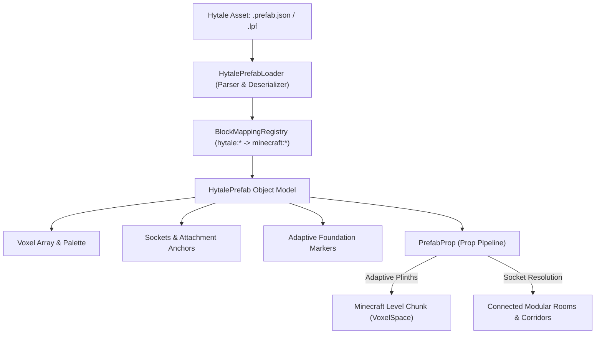

# Hytale WorldGen V2: Prefab & Blueprint Translator Architecture

## 1. Executive Summary

A critical requirement for bringing Hytale WorldGen V2 into Minecraft 26.1 is the ability to **translate, load, and execute existing Hytale structure blueprints and prefabs** (`.prefab.json` and `.lpf`) directly within Minecraft.

This document specifies the technical architecture for the **Hytale-to-Minecraft Prefab Translation Engine**, detailing:
1. **The Hytale Prefab Format (`.prefab.json`)** schema.
2. **The Dynamic Block & State Mapping Registry** (`BlockMappingRegistry`).
3. **The Socket & Attachment Translation Pipeline** for modular procedural dungeons.
4. **Adaptive Foundation Plinths** for uneven terrain anchoring.
5. **Runtime Direct Execution** in the `StagedChunkGenerator` via `PrefabProp`.



---

## 2. Hytale Prefab Data Structure (`.prefab.json`)

Hytale prefabs use a sparse coordinate layout relative to an anchor point $(0, 0, 0)$, containing a block palette, voxel offsets, state properties, sockets, and metadata.

### 2.1 JSON Schema Specification
```json
{
  "$schema": "https://hytale.com/schemas/prefab/v2.json",
  "name": "hytale:settlements/kweebec_shelter_01",
  "version": 2,
  "size": { "x": 9, "y": 7, "z": 9 },
  "anchor": { "x": 4, "y": 0, "z": 4 },
  
  "palette": [
    { "id": 0, "name": "hytale:empty" },
    { "id": 1, "name": "hytale:wood_oak_planks" },
    { "id": 2, "name": "hytale:wood_oak_log", "properties": { "axis": "y" } },
    { "id": 3, "name": "hytale:stone_cobble" },
    { "id": 4, "name": "hytale:thatch_roof_stairs", "properties": { "facing": "north", "half": "bottom" } },
    { "id": 5, "name": "hytale:torch_wall", "properties": { "facing": "south" } }
  ],

  "blocks": [
    { "x": 0, "y": 0, "z": 0, "paletteIndex": 3 },
    { "x": 0, "y": 1, "z": 0, "paletteIndex": 2 },
    { "x": 0, "y": 2, "z": 0, "paletteIndex": 2 }
  ],

  "sockets": [
    {
      "name": "doorway_front",
      "type": "CORRIDOR_CONNECTION",
      "gender": "SOCKET_FEMALE",
      "position": { "x": 4, "y": 0, "z": 0 },
      "facing": "NORTH",
      "compatibleTags": ["path", "courtyard"]
    }
  ],

  "adaptiveFoundations": [
    {
      "area": { "minX": 0, "minZ": 0, "maxX": 8, "maxZ": 8 },
      "fillMaterial": "hytale:stone_cobble",
      "maxDepth": 16
    }
  ]
}
```

---

## 3. The Block & State Mapping Registry (`BlockMappingRegistry`)

Because Hytale block names do not match Minecraft block names 1:1, the translation engine uses a bidirectional, rule-based **Block Mapping Registry**.

### 3.1 Mapping Rules Engine
The mapping table translates both the block identifier and its discrete state properties:

| Hytale Block | Hytale Properties | Minecraft Target | Minecraft Properties |
| :--- | :--- | :--- | :--- |
| `hytale:stone_cobble` | — | `minecraft:cobblestone` | — |
| `hytale:wood_oak_log` | `{"axis": "y"}` | `minecraft:oak_log` | `[axis=y]` |
| `hytale:wood_oak_planks`| — | `minecraft:oak_planks` | — |
| `hytale:thatch_roof_stairs` | `{"facing": "north", "half": "bottom"}` | `minecraft:oak_stairs` or `minecraft:bamboo_stairs` | `[facing=north,half=bottom,shape=straight]` |
| `hytale:torch_wall` | `{"facing": "south"}` | `minecraft:wall_torch` | `[facing=south]` |
| `hytale:plant_grass_tall`| — | `minecraft:tall_grass` | `[half=lower]` + top block |
| `hytale:fluid_water` | — | `minecraft:water` | `[level=0]` |

### 3.2 Unknown Block Fallback Strategy
If a Hytale prefab references a custom fantasy material (e.g., `hytale:crystal_void_shards` or `hytale:ancient_runestone`), the translator uses a tiered fallback:
1. **Explicit Alias:** Checks user-configured overrides (`config/hytale/mappings.json`).
2. **Category Heuristic:**
   * Words containing `stone`, `rock`, `slate` $\to$ `minecraft:deepslate` / `stone`.
   * Words containing `wood`, `timber`, `bark` $\to$ `minecraft:spruce_wood`.
   * Words containing `leaf`, `foliage`, `vine` $\to$ `minecraft:oak_leaves`.
3. **Hard Fallback:** Replaces with `minecraft:polished_andesite` or marks with a visible debug placeholder so designers can inspect missing mappings.

---

## 4. Socket & Attachment Translation (Modular Blueprints)

Hytale dungeons and large castles are not single static models; they are assemblies of modular prefabs linked together by **Sockets**.

### 4.1 How the Translator Preserves Socket Awareness
When translating a Hytale prefab:
1. **In-Memory Retention:** Sockets are preserved in the `HytalePrefab` object model as `PrefabSocket` instances.
2. **Jigsaw Compatibility (Optional Export):** When converting to Minecraft `.nbt` structure templates, sockets can be translated into Minecraft `minecraft:jigsaw` blocks, allowing vanilla Minecraft structure managers to recognize them.
3. **Native V2 Socket Engine:** During `PropStage`, our mod's native **Socket Expansion Resolver** traverses active sockets:
   * Finds open socket `doorway_front`.
   * Queries matching child prefabs with tag `path`.
   * Rotates and aligns the child prefab so its plug socket matches `doorway_front`.
   * Commits the connected room into the chunk.

```
Socket Connection Flow:
[ Parent Room Prefab ] ───(Socket: SOUTH)───► [ Child Corridor Prefab ] ───(Socket: EAST)───► [ Chamber ]
```

---

## 5. Adaptive Foundation Plinths (Terrain Conformance)

In traditional voxel engines, stamping a flat prefab onto uneven hills creates the notorious **"Floating Building"** glitch, where half of the foundation hangs over empty air.

### 5.1 The Adaptive Foundation Pipeline
Hytale prefabs define `adaptiveFoundations` rules. When translated:
1. The translator records which lower perimeter blocks are designated as foundation mass.
2. During world placement (`generate(Prop.Context)`), for each column $(x, z)$ along the foundation base:
   * The engine checks if the terrain immediately below the prefab floor is solid:
     $$\text{isSolid}(x, y_{\text{base}} - 1, z)$$
   * If air is detected, the engine executes **Plinth Marching**:
     It casts a vertical ray downwards, placing the foundation material (e.g., cobblestone or stone bricks) block-by-block until it contacts solid native terrain:
     $$\forall y \in [y_{\text{terrain}}, y_{\text{base}} - 1], \quad \text{setBlock}(x, y, z, \text{foundationBlock})$$
3. This creates seamless, natural stone pillars and retainment walls that firmly anchor buildings to slopes, cliffs, and riverbanks.

---

## 6. Runtime Hot-Loading & In-Game Commands

The translator is built into both the mod's startup pipeline and in-game developer commands:

* **Automatic Asset Loading:** Any `.prefab.json` or `.lpf` placed in `src/main/resources/data/hytaleworldgen/prefabs/` (or server datapacks) is dynamically parsed and registered into the mod's `PrefabRegistry`.
* **In-Game Commands:**
  * `/hytale test-prefab <name> [x y z]`: Stamps a translated Hytale prefab at the player's crosshair for instant visual testing.
  * `/hytale reload-prefabs`: Re-reads and re-translates all JSON prefab blueprints from disk without server restarts.
