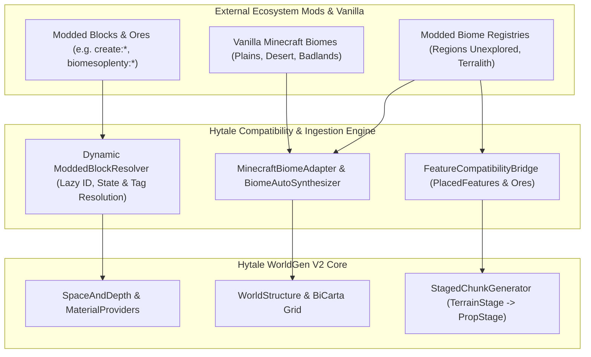
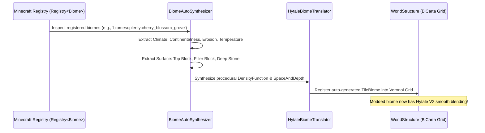

# Hytale WorldGen V2: Mod Compatibility, Dynamic Blocks & Biome Ingestion

## 1. Executive Summary

A successful world generation foundation cannot exist in a vacuum. The Minecraft modding ecosystem relies on hundreds of popular mods that introduce custom blocks (modded stones, timbers, grasses, ores) and custom biomes (e.g., *Biomes O' Plenty*, *Terralith*, *Regions Unexplored*).

To make our Hytale WorldGen V2 engine universally compatible, we implement a **Three-Tiered Compatibility Architecture**:



---

## 2. Dynamic Modded Block Resolution (`ModdedBlockResolver`)

### 2.1 The Challenge
If a Hytale JSON definition or user config references a block from another mod (e.g., `biomesoplenty:origin_grass_block` or `create:scoria`), the engine must not crash if that mod is absent, and must natively resolve the exact `BlockState` and property tags if the mod is present.

### 2.2 Architectural Implementation
`ModdedBlockResolver` handles block resolution dynamically at runtime:
1. **Namespaced String IDs:** Parses any standard namespaced string (`"modid:block_name[property=value]"`).
2. **Minecraft Common Tags:** Supports tag selectors (e.g., `"#c:stones"`, `"#c:logs/oak"`, `"#minecraft:base_stone_overworld"`). If a tag is specified, the resolver picks the appropriate registered block matching that tag.
3. **Lazy Registry Lookup:** Queries Minecraft's `BuiltInRegistries.BLOCK` on demand.
4. **Resilient Fallback Chains:**
   ```json
   {
     "material": "biomesoplenty:fir_log",
     "fallback": ["regions_unexplored:pine_log", "minecraft:spruce_log", "minecraft:oak_log"]
   }
   ```
   If `biomesoplenty` is not installed, it cascades down the chain and uses `minecraft:spruce_log` seamlessly without warnings or crashes.

---

## 3. The Biome Auto-Synthesizer (`BiomeAutoSynthesizer`)

### 3.1 Automatic Ingestion of Vanilla & Modded Biomes
Instead of forcing modders to manually write Hytale V2 node graphs for all 60+ vanilla Minecraft biomes and dozens of modded biomes, the **`BiomeAutoSynthesizer`** automatically inspects `Registry<Biome>` during world loading:



### 3.2 Climate Parameter Mapping
Minecraft's multi-noise parameters are automatically converted into Hytale V2 mathematical terrain nodes:

| Minecraft Climate Parameter | Hytale V2 Mathematical Synthesis |
| :--- | :--- |
| **Continentalness** (Ocean $\to$ Inland) | Maps to baseline vertical gradient height $y_{\text{base}} \in [48, 120]$. |
| **Erosion** (Jagged Peaks $\to$ Flat Plains) | Controls the amplitude of 3D `FastNoiseLite` high-frequency octaves ($A_{\text{noise}} \propto 1.0 - \text{erosion}$). |
| **Weirdness / Peaks & Valleys** | Controls `RidgedMultifractal` spine sharpening and fracture canyon carving. |
| **Temperature & Downfall** | Maps to foliage tint palettes, snow elevations, and fluid surface behaviors. |

---

## 4. Why This Gives the Best of Both Worlds

1. **Out-of-the-Box Mod Pack Compatibility:**
   * Any mod adding biomes (*Terralith*, *Biomes O' Plenty*, *Alex's Caves*, etc.) automatically works! Their biomes are absorbed into Hytale's cellular `BiCarta` Voronoi grid.
   * Modded biomes automatically gain **Hytale V2's continuous distance blending** (`DefaultTransitionDistance`), eliminating the ugly harsh chunk borders common in standard Minecraft mod packs.
2. **Modded Ores & Vegetation Preservation:**
   * During `PropStage` and `TerrainStage`, the generator invokes the `FeatureCompatibilityBridge`, executing modded ore veins (copper, tin, lead, vibranium) and modded tree decorators inside their respective biomes.
3. **Progressive Handcrafting:**
   * Modpack authors can start with 100% auto-synthesized biomes, and progressively replace individual biomes with bespoke, handcrafted Hytale V2 node graphs (`Server/HytaleGenerator/Biomes/`) whenever they want custom soaring arches, floating islands, or specialized prefabs!
