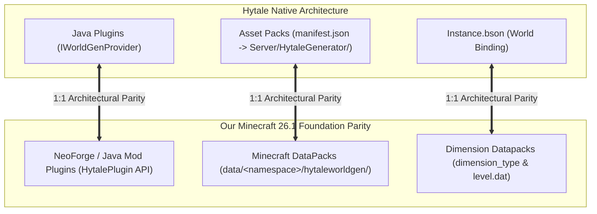

# Hytale WorldGen V2: Modding Ecosystem Integration & DataPack Parity

## 1. Executive Summary: How Hytale Handles WorldGen Mods

In Hytale, world generation was architected from the very beginning to be **fully moddable and extensible at both the data level and the code level**:

1. **The Code Layer (Java Plugins & Providers):**
   * Built around `IWorldGenProvider` and `com.hypixel.hytale.server.worldgen`.
   * Java plugins can register custom procedural density nodes, custom material providers, custom prop rules, and even alternative world generator implementations alongside `HytaleGenerator`.
2. **The Data Layer (Asset Packs & `manifest.json`):**
   * Modders can create standalone asset packs without writing a single line of Java code.
   * Dropping an asset pack with a `manifest.json` into the server's `Mods/` directory allows creators to inject new biomes (`Server/HytaleGenerator/Biomes/`), override vanilla biomes, introduce new modular prefabs (`.prefab.json`), or alter the macro `WorldStructure`.
3. **The Instance Layer (`Instance.bson`):**
   * World instances bind directly to generator profiles (`"Type": "HytaleGenerator", "WorldStructure": "Basic"`), declaring custom spawn coordinates and dimension parameters.



---

## 2. Direct Architectural Parity in Minecraft 26.1

Our Minecraft 26.1 implementation mirrors Hytale's exact modding pipeline, utilizing standard Minecraft and NeoForge systems so it feels completely natural to Minecraft modders while retaining 100% of Hytale's power:

### 2.1 The DataPack Hierarchy (`data/<namespace>/hytaleworldgen/`)

In Minecraft 26.1, datapacks and mods share the standard asset tree. We map Hytale's asset directories directly into namespaced Minecraft resources:

```
data/<namespace>/hytaleworldgen/
├── biomes/
│   ├── verdant_forest.json
│   ├── custom_crystal_caves.json
│   └── overrides/
├── prefabs/
│   ├── goblin_outpost.prefab.json
│   └── ancient_ruins.prefab.json
├── materials/
│   └── enchanted_strata.json
└── world_structures/
    └── default_orbis.json
```

### 2.2 Asset Overriding & Pack Priority
Just like Hytale's asset pack layering, Minecraft DataPacks have strict loading priority:
1. **Core Mod Defaults (`hytaleworldgen:*`):** Official presets (*Verdant Forest*, *Howling Sands*, etc.).
2. **Third-Party WorldGen Mods:** Any installed mod can add new biomes to its own namespace (e.g. `alexscaves:abyssal_chasm.json`).
3. **Server / World DataPacks:** Server owners can override any biome or structure simply by matching the file path in their world datapack (e.g., `data/hytaleworldgen/biomes/verdant_forest.json`), replacing the terrain curve or material layers without recompiling any jar.

---

## 3. Code-Level Extensibility (The Hytale Plugin API for Minecraft)

For modders who want to write custom compiled Java logic (e.g., a magic mod that adds a `ManaDensityNode` or a tech mod with a `CableMaterialProvider`), our foundation exposes an open, registry-based API:

### 3.1 Registry Hooks
* **`HytaleRegistries.DENSITY_NODE_TYPE`:** Register custom mathematical density nodes.
* **`HytaleRegistries.MATERIAL_PROVIDER_TYPE`:** Register custom procedural block deciders.
* **`HytaleRegistries.PROP_TYPE`:** Register custom structure and decoration spawners.
* **`HytaleRegistries.WORLD_STRUCTURE`:** Register custom macro zone layouts.

### 3.2 Example: Third-Party Mod Registering a Custom Density Node
```java
// A third-party mod can register a custom density function type:
HytaleRegistries.DENSITY_NODE_TYPE.register(
    ResourceLocation.fromNamespaceAndPath("mymod", "mana_field_density"),
    ManaFieldDensity::deserialize
);
```
Once registered, any creator can use `"type": "mymod:mana_field_density"` inside their biome JSON files!

---

## 4. Verification of Our Approach

By comparing our implementation with Hytale's published systems:

1. **Decoupled Engine Core:** Hytale isolates `hytalegenerator/engine` from server entity loops; our project isolates `com.hypixel.hytale.builtin.hytalegenerator` from Minecraft server loops.
2. **Data-Driven Declarative Biomes:** Hytale defines biomes as JSON ASTs; our mod parses and compiles those exact JSON ASTs at runtime.
3. **Universal Extensibility:** Hytale allows mods to add prefabs, biomes, and material providers; our mod allows Minecraft mods and DataPacks to add the exact same assets seamlessly.

We are taking the exact right architectural approach: honoring Hytale's design philosophy while seamlessly integrating into the modern, deobfuscated Minecraft 26.1 ecosystem.
