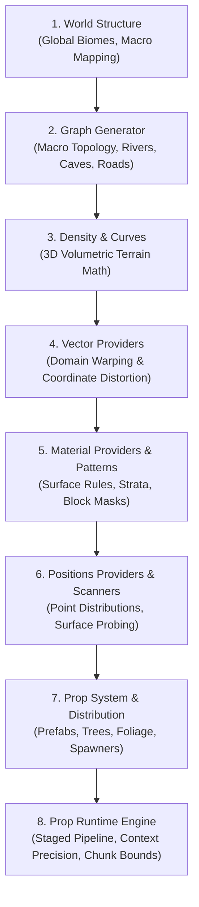

# Chapter 17: Official Hytale World Generator Specifications & Architecture

> **Source:** Official Hytale World Generator Documentation ([https://docs.hytale.com/hytale-generator/](https://docs.hytale.com/hytale-generator/))  
> **Archived Reference Folder:** [hytale_generator_docs/](hytale_generator_docs/00_INDEX_AND_SUMMARY.md)  
> **Searchable Master Compilation:** [HYTALE_GENERATOR_ALL_IN_ONE_REFERENCE.md](hytale_generator_docs/HYTALE_GENERATOR_ALL_IN_ONE_REFERENCE.md)  
> **Integration Target:** Minecraft 1.26.1 NeoForge `Minecraft Worldgen V2` Engine

---

## 1. Architectural Overview & Paradigm

The official Hytale Generator is an asset-driven, node-graph procedural generation architecture. Unlike legacy voxel terrain engines that rely heavily on 2D heightmaps or monolithic hardcoded noise generators, Hytale decomposes world generation into **eight modular subsystems**:



---

## 2. Ingested Categories & Technical Specifications

All 24 official documentation categories and subcategories have been scraped, formatted into GitHub Flavored Markdown, and archived locally within this repository:

### 2.1 Volumetric Math & Density (`docs/research/hytale_generator_docs/density.md`)
*   **Constant**: Outputs a scalar constant decimal.
*   **SimplexNoise2D & SimplexNoise3D**: Multi-octave coherent simplex noise fields with explicit controls for `Lacunarity`, `Persistence`, `Scale` / `ScaleXZ` / `ScaleY`, `Octaves`, and `Seed`.
*   **WhiteNoise**: Fast 3D stochastic pseudo-random field in range `[-1, 1]`.
*   **CellNoise / Voronoi**: Cellular noise computing distances to nearest feature points, distance to edges, and cell IDs.
*   **Mathematical Operations**: `Add`, `Subtract`, `Multiply`, `Divide`, `Min`, `Max`, `Clamp`, `Invert`, `Abs`, `Pow`, `Sqrt`.
*   **Coordinate Remapping & Blending**: `Lerp`, `Smoothstep`, `Normalizer`, `DistanceTransform`, `RadialFade`.
*   **Caching & SingleInstance Optimization**: Nodes can cache intermediate evaluation results per $(x, z)$ column or $(x, y, z)$ block. The `SingleInstance` node guarantees that shared exported subgraphs share underlying cache instances rather than duplicating evaluation across imported pins.

### 2.2 Curves & Transfer Functions (`docs/research/hytale_generator_docs/curve.md`)
Curves map 1D inputs to 1D outputs $f(x) = y$:
*   **Linear & Step Curves**: Discrete stair-stepping and linear interpolation.
*   **Hermite Splines & Smoothstep**: C1/C2 continuous splines ensuring smooth terrain transitions without visible derivative discontinuities.
*   **Invert & Clamp**: Restricting or flipping transfer ranges.

### 2.3 Vector Providers (`docs/research/hytale_generator_docs/vector-provider.md`)
Vector Providers generate 3D directional vectors $\{x, y, z\}$ used for:
*   **Domain Warping**: Offsetting sampling coordinates $(x', y', z') = (x + V_x, y + V_y, z + V_z)$ before querying density fields (creating turbulent overhangs, winding ravines, and eroded arches).
*   **Directional Gradients**: Defining fluid flow vectors, wind directions for foliage orientation, and tectonic drift.

### 2.4 Materials, Block Masks & Patterns (`docs/research/hytale_generator_docs/material-provider.md`, `block-mask.md`, `pattern.md`)
*   **Material**: Distinguishes solid blocks and fluid states, with 3D rotation metadata (`Yaw`, `Pitch`, `Roll` in increments of 90 degrees).
*   **Material Provider**: Assigns materials based on world coordinates, height, slope/angle, depth below surface, and volumetric density.
*   **Block Mask**: Formalizes replacement semantics between **Source Material** (the block being placed) and **Destination Material** (the existing block in the world buffer).
*   **Pattern**: Boolean validation filter that queries spatial voxel neighborhoods, material composition, and geometric constraints before allowing feature placement.

### 2.5 Positions Providers & Scanners (`docs/research/hytale_generator_docs/positions-provider.md`, `scanner.md`)
*   **Positions Provider**: Generates infinite point fields:
    *   `TriangularGrid2d`: Hexagonal/triangular spatial tessellation with equilateral spacing.
    *   `PoissonDisk`: Blue-noise minimum-distance point distributions.
    *   `JitteredGrid`: Regular grid with stochastic perturbation.
*   **Scanner**: Local raycasting probes that search column vectors to detect ground surfaces, ceilings, water boundaries, or open air pockets with user-defined offsets and search distances.

### 2.6 Props, Distribution & Runtime (`docs/research/hytale_generator_docs/prop.md`, `prop-distribution.md`, `prop-runtime.md`, `assignments.md`)
*   **Prop**: Base unit of localized structural content (Cuboids, Prefabs, Compound structures).
*   **Assignments**: Matches specific props to generated positions based on probability weights or biome parameters.
*   **Prop Runtime & Staged Pipeline**: Solves the circular dependency problem between features (e.g. grass needing dirt, trees needing grass, vines needing trees, dungeons carving trees):
    *   Features are assigned to discrete **Stages** ($0, 1, 2, \dots, N$).
    *   **Context Size & Precision**: Stage context size dictates how many neighboring chunks must be evaluated to ensure seamless boundary stitching.
    *   **Context Precision Modes**: Allows tuning between strict bounding boxes and approximate dynamic bounds to balance chunk generation throughput against memory footprint.

### 2.7 Procedural Graph Generator Subsystem (`docs/research/hytale_generator_docs/graph-generator/`)
The Graph Generator generates macro-scale topological networks:
*   **Graph Passes**: Successive stages that build and mutate a mathematical graph $(V, E)$.
*   **Node & Edge Selectors**: Filtering nodes and edges by degree, distance, elevation, or cluster ID.
*   **Node & Edge Actions**: Adding nodes, connecting neighbors (Delaunay triangulation / Relative Neighborhood Graph), splitting edges, or subdividing paths.
*   **Content Suppliers & Predicates**: Attaching density carvers, river corridors, prop distributions, or road materials along selected edges and nodes.

---

## 3. Direct Translation to Minecraft Worldgen V2

| Official Hytale Generator Concept | Hytale Specification | Minecraft Worldgen V2 Implementation |
| :--- | :--- | :--- |
| **Density 3D** | Volumetric scalar field $f(x, y, z) \in [-1, 1]$ | `net.minecraft.world.level.levelgen.DensityFunction` + JNI `FastNoiseLite` SIMD evaluation |
| **Curve** | Transfer function $y = f(x)$ | `CubicSpline` / `HermiteSpline` lookup tables |
| **Vector Provider** | Domain warping $\vec{v}(x,y,z)$ | `DensityFunction` 3D displacement vectors |
| **Material Provider** | Biome strata & surface rules | `SurfaceRules.RuleSource` & `MaterialRule` pipeline |
| **Block Mask** | Source vs Destination replacement filter | `BlockPredicate` / `TagKey<Block>` replacement masks |
| **Pattern** | Neighborhood voxel condition | `BlockColumn` / `WorldGenLevel` neighborhood query |
| **Positions Provider** | Grid & Poisson point distributions | Custom `PlacementModifier` & Blue-Noise samplers |
| **Scanner** | Raycast & surface search | `Heightmap` & `SurfaceWaterDepthFilter` scanners |
| **Prop & Assignments** | Prefab & cuboid placement | `StructureTemplate` / `WorldgenStructure` / `PlacedFeature` |
| **Prop Runtime Stages** | Ordered execution stages ($0 \dots N$) with context bounds | Multi-phase chunk status pipeline (`STRUCTURE_STARTS` $\to$ `BIOMES` $\to$ `NOISE` $\to$ `SURFACE` $\to$ `FEATURES`) |
| **Graph Generator** | Topological node/edge network passes | Procedural Voronoi graph solver for river basins, cave corridors, and road networks |

---

## 4. Local Archive Directory Structure

All scraped official documents are organized in `docs/research/hytale_generator_docs/`:

```text
docs/research/hytale_generator_docs/
├── 00_INDEX_AND_SUMMARY.md                      # Comprehensive category index & summary
├── HYTALE_GENERATOR_ALL_IN_ONE_REFERENCE.md      # 158KB complete searchable master reference
├── index.md                                     # Official generator introduction
├── assignments.md                               # Assignments system
├── block-mask.md                                # Block mask replacement rules
├── curve.md                                     # Mathematical curve functions
├── density.md                                   # 3D Density functions & noise nodes
├── material.md                                  # Solid & fluid material definitions
├── material-provider.md                         # Terrain strata & surface rules
├── pattern.md                                   # Composition & validation patterns
├── positions-provider.md                        # Point distribution generators
├── prop.md                                      # Localized props & prefabs
├── prop-distribution.md                         # Prop distribution fields
├── prop-runtime.md                              # Staged execution & context precision
├── scanner.md                                   # Surface & raycast scanners
├── vector-provider.md                           # 3D vector fields & domain warping
├── world-structure.md                           # World-level biomes & global settings
└── graph-generator/                             # Procedural graph generation subsystem
    ├── content-predicate.md
    ├── content-supplier.md
    ├── edge-action.md
    ├── edge-selector.md
    ├── graph-content.md
    ├── graph-generator.md
    ├── graph-pass.md
    ├── node-action.md
    └── node-selector.md
```

This research archive ensures our project has an authoritative, offline, fully version-controlled reference of the entire Hytale World Generator specification to guide our Minecraft 1.26.1 world generation engine implementation.
