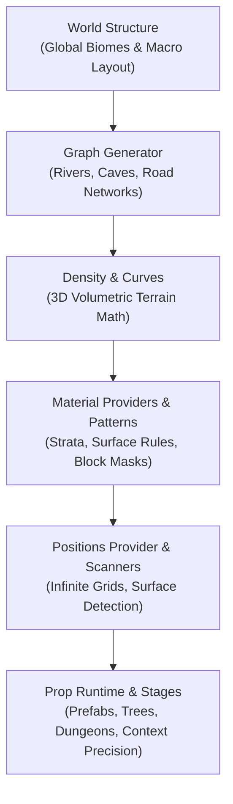

# Official Hytale Generator Documentation Archive & Reference

> **Archived from:** [https://docs.hytale.com/hytale-generator/](https://docs.hytale.com/hytale-generator/)  
> **Status:** Complete Official Reference (All 24 Categories & Subcategories Ingested)  
> **Workspace Integration:** `docs/research/hytale_generator_docs/`

---

## Executive Summary & System Architecture

The official Hytale World Generator is a modular, node-graph-driven, staged procedural generation engine. Rather than relying on rigid heightmaps or monolithic hardcoded algorithms, Hytale decomposes world generation into distinct mathematical primitives and functional pipelines:

---

## Complete Category & Node Index

### Overview & Core

| Page / Category | Local Document | Official Documentation Link |
| :--- | :--- | :--- |
| **Hytale Generator Overview** | [Hytale Generator Overview](index.md) | [https://docs.hytale.com/hytale-generator/](https://docs.hytale.com/hytale-generator/) |
| **World Structure** | [World Structure](world-structure.md) | [https://docs.hytale.com/hytale-generator/world-structure/](https://docs.hytale.com/hytale-generator/world-structure/) |

### Volumetric Terrain & Math

| Page / Category | Local Document | Official Documentation Link |
| :--- | :--- | :--- |
| **Density (3D Fields & Noise)** | [Density (3D Fields & Noise)](density.md) | [https://docs.hytale.com/hytale-generator/density/](https://docs.hytale.com/hytale-generator/density/) |
| **Curve (Math Transfer Functions)** | [Curve (Math Transfer Functions)](curve.md) | [https://docs.hytale.com/hytale-generator/curve/](https://docs.hytale.com/hytale-generator/curve/) |
| **Vector Provider (3D Vectors & Warping)** | [Vector Provider (3D Vectors & Warping)](vector-provider.md) | [https://docs.hytale.com/hytale-generator/vector-provider/](https://docs.hytale.com/hytale-generator/vector-provider/) |

### Materials, Strata & Blocks

| Page / Category | Local Document | Official Documentation Link |
| :--- | :--- | :--- |
| **Material (Solid & Fluid Blocks)** | [Material (Solid & Fluid Blocks)](material.md) | [https://docs.hytale.com/hytale-generator/material/](https://docs.hytale.com/hytale-generator/material/) |
| **Material Provider (Terrain & Surface Rules)** | [Material Provider (Terrain & Surface Rules)](material-provider.md) | [https://docs.hytale.com/hytale-generator/material-provider/](https://docs.hytale.com/hytale-generator/material-provider/) |
| **Block Mask (Replacement Rules)** | [Block Mask (Replacement Rules)](block-mask.md) | [https://docs.hytale.com/hytale-generator/block-mask/](https://docs.hytale.com/hytale-generator/block-mask/) |
| **Pattern (Position & Composition Validation)** | [Pattern (Position & Composition Validation)](pattern.md) | [https://docs.hytale.com/hytale-generator/pattern/](https://docs.hytale.com/hytale-generator/pattern/) |

### Positions, Scanning & Placement

| Page / Category | Local Document | Official Documentation Link |
| :--- | :--- | :--- |
| **Positions Provider (Point Fields & Grids)** | [Positions Provider (Point Fields & Grids)](positions-provider.md) | [https://docs.hytale.com/hytale-generator/positions-provider/](https://docs.hytale.com/hytale-generator/positions-provider/) |
| **Scanner (Raycasting & Surface Probing)** | [Scanner (Raycasting & Surface Probing)](scanner.md) | [https://docs.hytale.com/hytale-generator/scanner/](https://docs.hytale.com/hytale-generator/scanner/) |
| **Assignments (Prop to Position Mapping)** | [Assignments (Prop to Position Mapping)](assignments.md) | [https://docs.hytale.com/hytale-generator/assignments/](https://docs.hytale.com/hytale-generator/assignments/) |

### Props, Prefabs & Runtime Stages

| Page / Category | Local Document | Official Documentation Link |
| :--- | :--- | :--- |
| **Prop (Localized Structures & Prefabs)** | [Prop (Localized Structures & Prefabs)](prop.md) | [https://docs.hytale.com/hytale-generator/prop/](https://docs.hytale.com/hytale-generator/prop/) |
| **Prop Distribution (Positioned Prop Fields)** | [Prop Distribution (Positioned Prop Fields)](prop-distribution.md) | [https://docs.hytale.com/hytale-generator/prop-distribution/](https://docs.hytale.com/hytale-generator/prop-distribution/) |
| **Prop Runtime (Staged Pipeline & Context)** | [Prop Runtime (Staged Pipeline & Context)](prop-runtime.md) | [https://docs.hytale.com/hytale-generator/prop-runtime/](https://docs.hytale.com/hytale-generator/prop-runtime/) |

### Procedural Graph Generator

| Page / Category | Local Document | Official Documentation Link |
| :--- | :--- | :--- |
| **Graph Generator Core** | [Graph Generator Core](graph-generator/graph-generator.md) | [https://docs.hytale.com/hytale-generator/graph-generator/graph-generator/](https://docs.hytale.com/hytale-generator/graph-generator/graph-generator/) |
| **Graph Pass** | [Graph Pass](graph-generator/graph-pass.md) | [https://docs.hytale.com/hytale-generator/graph-generator/graph-pass/](https://docs.hytale.com/hytale-generator/graph-generator/graph-pass/) |
| **Graph Content** | [Graph Content](graph-generator/graph-content.md) | [https://docs.hytale.com/hytale-generator/graph-generator/graph-content/](https://docs.hytale.com/hytale-generator/graph-generator/graph-content/) |
| **Node Selector** | [Node Selector](graph-generator/node-selector.md) | [https://docs.hytale.com/hytale-generator/graph-generator/node-selector/](https://docs.hytale.com/hytale-generator/graph-generator/node-selector/) |
| **Node Action** | [Node Action](graph-generator/node-action.md) | [https://docs.hytale.com/hytale-generator/graph-generator/node-action/](https://docs.hytale.com/hytale-generator/graph-generator/node-action/) |
| **Edge Selector** | [Edge Selector](graph-generator/edge-selector.md) | [https://docs.hytale.com/hytale-generator/graph-generator/edge-selector/](https://docs.hytale.com/hytale-generator/graph-generator/edge-selector/) |
| **Edge Action** | [Edge Action](graph-generator/edge-action.md) | [https://docs.hytale.com/hytale-generator/graph-generator/edge-action/](https://docs.hytale.com/hytale-generator/graph-generator/edge-action/) |
| **Content Predicate** | [Content Predicate](graph-generator/content-predicate.md) | [https://docs.hytale.com/hytale-generator/graph-generator/content-predicate/](https://docs.hytale.com/hytale-generator/graph-generator/content-predicate/) |
| **Content Supplier** | [Content Supplier](graph-generator/content-supplier.md) | [https://docs.hytale.com/hytale-generator/graph-generator/content-supplier/](https://docs.hytale.com/hytale-generator/graph-generator/content-supplier/) |

---

## Cross-Referenced Engine Mapping

For an exhaustive architectural analysis of how these official Hytale Generator nodes map directly onto our Minecraft 1.26.1 Worldgen V2 engine implementation, refer to:
- [17_OFFICIAL_HYTALE_GENERATOR_SPECIFICATIONS.md](../17_OFFICIAL_HYTALE_GENERATOR_SPECIFICATIONS.md)
- [HYTALE_GENERATOR_ALL_IN_ONE_REFERENCE.md](HYTALE_GENERATOR_ALL_IN_ONE_REFERENCE.md) (Full searchable single-file reference)
